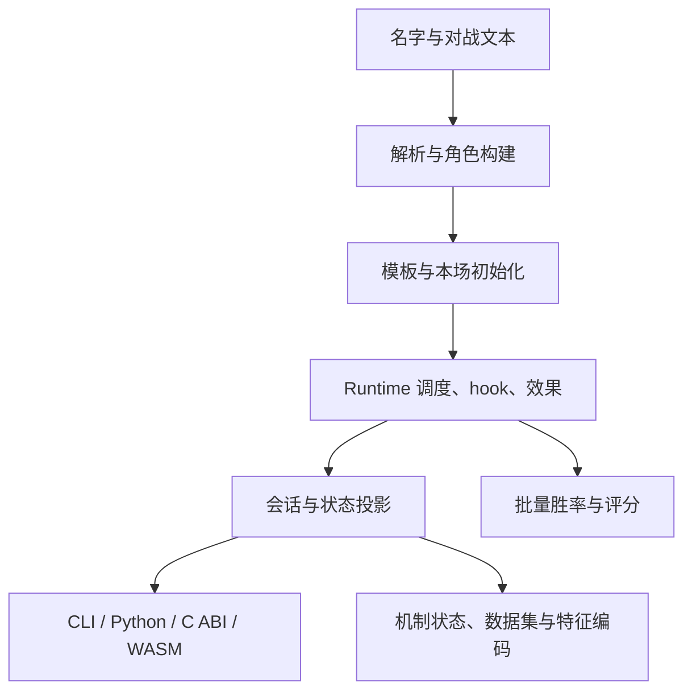

# 从名字竞技场到 tswn：项目与 core 原理指南

[指南首页](README.md) · 上一篇：[文档中心](../README.md) · 下一篇：[项目地图](project-map.md)

这套指南面向已经了解 namerena 游戏、希望理解或使用 tswn 的读者。你熟悉的名字、八围、技能、阵营、召唤物与战斗消息，在这里都会对应到具体数据结构和执行阶段。阅读时可以先沿着一场对局走，再按兴趣深入 hook、语言绑定、批量工具或学习数据。

**初稿基准：2026-10-14，core 0.7.0、WASM 0.5.7；2026-10-23 复核现行入口与展示说明。** 初稿版本号不是当前安装清单；当前版本与 feature 以各 crate 的 Cargo.toml 为准。字段和签名可以通过源码链接与 Cargo doc 继续查阅，版本变化由各 crate CHANGELOG 记录。

## 阅读路线

| 想了解什么 | 建议顺序 | 读完能做什么 |
| --- | --- | --- |
| 项目整体是什么 | [项目地图](project-map.md) → [一场战斗](battle-flow.md) | 找到各工具与 core 的关系 |
| 熟悉游戏，第一次看引擎 | [角色构建](name-to-player.md) → [运行时模型](runtime-model.md) → [战斗流程](battle-flow.md) | 将游戏概念映射到代码 |
| 技能和状态怎样执行 | [技能与 hook](skills-and-hooks.md) → [状态与召唤物](statuses-and-minions.md) | 理解阶段、排序、嵌套效果和归属 |
| 接入网页、程序或脚本 | [会话与回放](sessions-and-replay.md) → [交互与工具](interfaces-and-tools.md) | 正确推进会话、处理结果和释放资源 |
| 对拍、复现或修改机制 | [随机与兼容](randomness-and-compatibility.md) → [开发与排查](contributing-and-debugging.md) | 固定输入和 seed，定位第一处差异 |
| 胜率、筛号或机器学习 | [项目地图](project-map.md) → [数据与批量计算](datasets-and-extension.md) | 选择 PreparedRunner、DS4 或 PWP 链路 |

### 用一个问题贯穿全书

> 输入 `left@red` 和 `right@blue` 后，程序怎样生成角色、决定行动者、执行技能、结算护盾，再把这一切呈现在网页里？



图：全书主线。前五章解释 A～D，第六至九章解释复杂机制、可复现性与界面接入，后两章介绍批量数据和开发方法。每张 Mermaid 图都配有一段文字或表格说明，源码视图与图片视图可互相对照。

## 五个先记住的词

| 词 | 在项目中的意思 | 熟悉游戏后的理解方式 |
| --- | --- | --- |
| 构建 | 从名字、阵营、武器和覆盖配置得到属性与技能 | “这个号入场时长什么样” |
| Runtime | 一场战斗正在变化的机制容器 | “现在这场战斗发生到哪里” |
| hook | 机制在某个阶段获得执行机会 | “行动前蓄盾、受击时反弹、击杀时吞噬” |
| effect | 排队提交的一次实际机制操作 | “伤害、恢复、召唤、复活” |
| DTO / 投影 | 为某种使用场景整理的输出数据 | “界面快照、播放片段或训练输入” |

## 在本机看 API 文档

从仓库根目录执行：

```powershell
cargo doc --workspace --no-deps
# 用浏览器打开 target/doc/tswn_core/index.html

# 深入 binary 或绑定内部实现时，生成含内部模块的文档
cargo doc --workspace --no-deps --document-private-items

# 只看核心 API，保留核心调试配置
cargo doc -p tswn_core --no-deps
```

Cargo doc 擅长按类型、方法和字段查阅；本指南擅长解释数据流和机制。两者配合阅读：在指南理解一个概念，再点进对应源码或 rustdoc 确认签名。

`tswn_name_ranker` 是独立排除的 crate，备齐它的校准资源后使用 `cargo doc --manifest-path crates/tswn_name_ranker/Cargo.toml --no-deps`。

## 与其他文档配合使用

- 实际命令和安装：[core README](../../crates/tswn_core/README.md)、[脚本索引](../../scripts/README.md)。
- 跨语言字段与错误：[公共 API 契约](../reference/public-api.md)。
- 完整输入格式：[DIY / OL 参考](../reference/diy-overlay.md)。
- 特定机制推导：[机制分析索引](../mechanics/README.md)。
- 特征编码规格：[FeatureEncoder](../design/feature-encoder-spec.md)。
- 构建、验证与性能：[开发指南](../guides/development.md)、[性能索引](../perf/README.md)。
- 项目起源与旧实现研究：[历史归档](../archive/README.md)。

---

[指南首页](README.md) · 上一篇：[文档中心](../README.md) · 下一篇：[项目地图](project-map.md)
