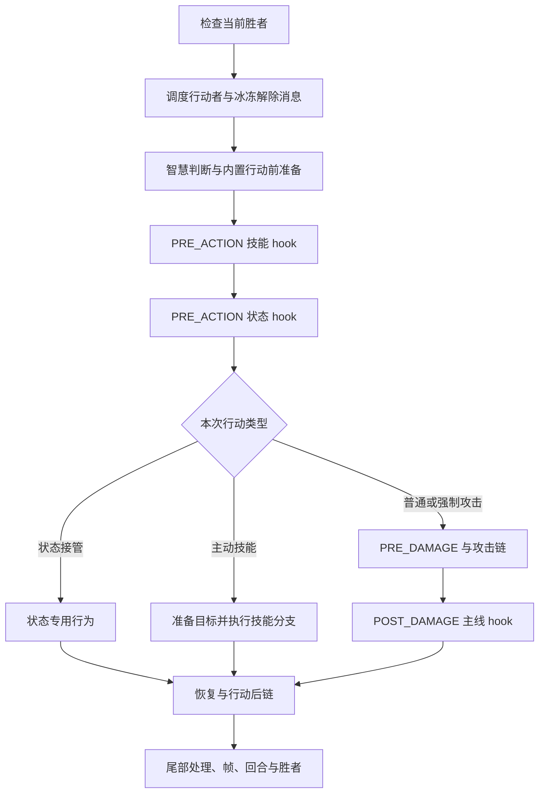
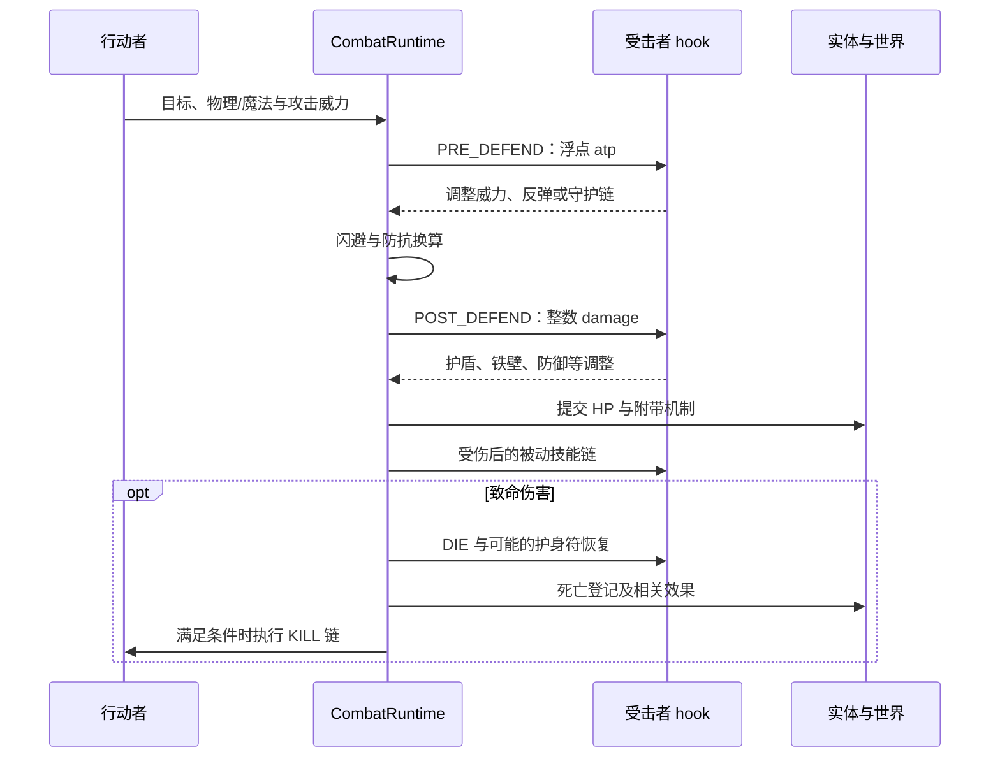

# 一场战斗怎样推进：行动条、攻击与效果链

[指南首页](README.md) · 上一篇：[运行时模型](runtime-model.md) · 下一篇：[技能与 hook](skills-and-hooks.md)

玩家眼中的“这回合用了什么技能”，在引擎中会经历行动选择、前置机制、目标与技能选择、攻击/状态分支、效果提交和收尾。每一阶段都可能读写状态、产生消息或消耗随机数。

## 先分清三个粒度

| 粒度 | 意思 | 一次可能发生什么 |
| --- | --- | --- |
| scheduler tick | 轮询一个候选行动者并推进其行动条 | 行动点增加、冰冻步进 |
| Runtime 回合 | runner 完成一次推进边界 | 一次行动、仅状态消息或空推进 |
| 可见 frame | 应用接收到的一批可见事件 | 多条消息、一个帧末快照 |

`BattleSession.next_frame()` 会连续推进空回合，直到有可见 frame 或正常终止。因此页面上的帧编号与 Runtime 回合编号各自有意义。

## 普通角色的行动条

`PhaseScheduler` 的 `LegacyStep` 模式对齐原游戏的速度步进。它轮询世界 roster，每个 tick 取一个 RC4 字节，用低两位得到 0～3 的步长，再结合有效速度和冰冻处理更新行动点。

```text
step_roll = next_u8() & 3
step = 冰冻处理(effective_speed × step_roll)
speed_points += step
当 speed_points > 2048：
    speed_points -= 2048
    获得一次行动机会
```

有效速度综合模板/runtime 与加速、减速等状态。初始行动点来自本场初始化；同一个名字在不同 seed 下可以处于不同起点和轮询顺序。

低层最小模板使用 `Minimal` 模式，可以直接选择行动者和基础目标，适合验证特定 hook。两种模式都在当前 Runtime 中实现，普通名字构造会选择相应的兼容调度。

## 行动主线



图：便于阅读的主线。代码还会结合冰冻、最终敌人消失、待生成实体和强制行动决定具体收尾路径；实际分支见 `combat/round.rs`。

### 智慧与行动选择

普通路径读取一个随机字节的低六位，以智慧值判定本次 `smart`。这个结果参与后续目标或技能选择。技能尝试遵循 loadout 的有序数据，选中后得到 `PreparedBuiltinSkillAction`，其中保存已解析的技能类型、固定 lane 和目标列表。

状态也能接管行动，例如魅惑、感染或其他特殊流程。接管后仍会沿适用的恢复与行动后链完成本次边界。

## 一次典型攻击怎样结算



图：典型默认攻击路径。火球、毒跳、驱散、爆炸与特定攻击入口各自选择适用阶段，研究某个技能时从它的效果分支继续追踪最清楚。

### 威力与伤害是两种值

`RuntimeDefendValue::Atp` 保存浮点威力；`RuntimeDefendValue::Damage` 保存整数伤害。两者对应 PRE_DEFEND 和 POST_DEFEND，handler 根据阶段读取和修改适合的值。

`PlayerRuntime::get_at` 的基础威力使用两组随机中值：

```text
a = median(r127, r127, r127, 属性 + 64, 属性)
b = median(r63 + 64, r63 + 64, 属性 + 64)
atp = a × b × at_boost
```

属性选择物理攻击或魔法。典型攻击在前置受击处理和闪避之后换算：

| 分支 | 防御分母 | 初步伤害 |
| --- | --- | --- |
| 物理 | `defense + 64` | `ceil(atp / 分母)` |
| 魔法 | `resistance + 64` | `ceil(atp / 分母)` |

随后 POST_DEFEND 继续调整整数伤害，最后提交 HP。技能倍率、Boss 规则、守护、反弹和状态效果在各自入口应用，所以具体机制应沿完整调用链阅读。

## 效果队列怎样组织连锁

hook 和技能可以直接使用专用上下文修改受击值，也可以提交 `QueuedEffect`：

| 操作 | 位置 | 适用例子 |
| --- | --- | --- |
| `push` | 队尾 | 排队执行恢复、状态或其他普通效果 |
| `push_nested` | 队首 | 优先完成嵌套反弹、吞噬等链路 |
| `pop_next` | 从队首取出 | Runtime 逐项提交并维护世界 |

效果 handler 还可以继续入队。连续加入队首的效果会按队首插入顺序形成优先关系，这是复现连锁机制时的重要信息。

`QueuedEffect::Damage`、`ReflectedAttack`、`PoisonTick` 等变体表达不同结算路径。例如反弹效果携带原来的附伤语义；毒跳有自己的清理和死亡后处理。

## 胜负与正常终止

世界视图持续维护存活队伍；规范会话额外选择安全终止策略。

| 终止原因 | 意义 | 面向应用的结果 |
| --- | --- | --- |
| `winner` | 当前已形成胜者 | `finished`，附赢家和最终状态 |
| `max_rounds` | 达到给定 Runtime 回合预算 | `truncated`，附最终状态与计数 |
| `no_progress` | 持续多个回合没有可见进展 | `truncated`，附最终状态与计数 |

当前会话先检查胜者，再检查回合上限，随后检查无进展保护。无进展阈值按现有实体数乘 16 计算，出现可见进展会重置计数。

Runtime 校验失败走错误通道；会话保存第一次错误，调用方读取 `is_failed` 并结束本次资源生命周期。详细 API 见 [会话与回放](sessions-and-replay.md)。

## 源码入口

- [scheduler.rs](../../crates/tswn_core/src/runtime/scheduler.rs)：行动条、行动与 hook 计划。
- [combat/round.rs](../../crates/tswn_core/src/runtime/combat/round.rs)：主线和行动后链。
- [combat/attack.rs](../../crates/tswn_core/src/runtime/combat/attack.rs)、[defense.rs](../../crates/tswn_core/src/runtime/combat/defense.rs)：攻击、受击、守护与致命链。
- [combat/effects.rs](../../crates/tswn_core/src/runtime/combat/effects.rs)：效果提交分支。
- [entity/runtime.rs](../../crates/tswn_core/src/runtime/entity/runtime.rs)：威力与有效属性。
- [battle/driver.rs](../../crates/tswn_core/src/cli_api/battle/driver.rs)：规范会话终止策略。

---

[指南首页](README.md) · 上一篇：[运行时模型](runtime-model.md) · 下一篇：[技能与 hook](skills-and-hooks.md)
