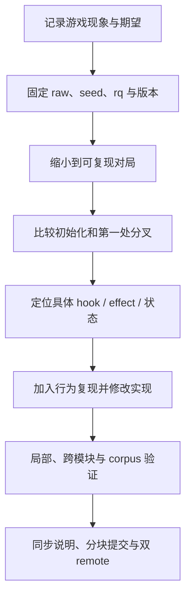

# 开发与排查：从游戏现象找到对应实现

[指南首页](README.md) · 上一篇：[数据与批量计算](datasets-and-extension.md) · 下一篇：[延伸阅读：文档中心](../README.md)

理解引擎后，最有效的开发方式是把“游戏里观察到的现象”转成“特定输入下的一段状态变化”，再沿职责链定位、修改和验证。这一章给出源码导航、排查路线和可直接使用的验证入口。

## 按问题找代码

| 观察到的问题 | 首先查看 | 接着追踪 |
| --- | --- | --- |
| 名字解析、空行分组、阵营 | `namerena/input.rs`、`runtime/prepared_init` | PlayerSpec 与本场排序 |
| 八围、名字因子、武器 | `namerena/build.rs`、`eval_name.rs`、`weapon.rs` | PreparedPlayer 与 profile 导入 |
| 技能等级、强化、顺序 | `namerena/skill.rs`、`entity/skill_loadout.rs` | active_order、fixed lane、当前等级 |
| 行动条、冰冻、谁先行动 | `runtime/scheduler.rs` | 初始行动点、world round_order 与 RNG |
| 攻击、闪避、护盾、反弹 | `combat/attack.rs`、`defense.rs`、`profile/hooks.rs` | Atp → Damage → HP 与嵌套效果 |
| 状态持续、注册与解除 | `entity/state`、`handlers/`、`combat/round.rs` | 载荷、游标和 deferred 清理 |
| 召唤、分身、亡灵、吞噬 | `combat/skills_lifecycle.rs`、`lifecycle.rs` | 蓝图、owner、策略与世界视图 |
| 帧、终止、DTO | `cli_api/battle` | driver 与 session 投影 |
| 播放片段、HP/盾变化 | `replay_view.rs` | rows、clips 与帧前后快照 |
| 网页视觉和交互 | `tswn_wasm/examples` | renderer、CSS、播放游标和 UI |
| C/Python/JS 返回异常 | 对应绑定 crate | 输入转换、错误映射与所有权 |
| 学习数据或张量 | `runtime/model_state.rs`、`encoder`、`tswn_pwp` | schema、引用、manifest 与容量 |

路径均相对相应 crate 的 `src/`，网页示例相对 `crates/`。完整入口从 [项目地图](project-map.md) 进入。

## 一次机制排查的节奏



图：从证据到修改，再回到可验证结果。新现象从输入和第一处差异开始，能减少在后续连锁结果之间来回猜测。

### 例子：观察护盾显示变化

1. 固定护盾熟练度与 seed，确认初始技能导入。
2. 观察 PRE_ACTION 是否产生实际 shield 变化。
3. 观察受击时整数伤害和 shield/HP 变化。
4. 对照 RuntimePlayerSnapshot 与 BattlePlayerState。
5. 最后查看网页 renderer 的颜色、尺度、拼接和详情文本。

这五步把机制、协议和显示分开验证：某一层正确后，再沿下一层定位问题。

## 可直接执行的验证

```powershell
# 受影响核心行为
cargo test -p tswn_core

# 跨 crate 与完整 Runtime corpus
cargo test --workspace --features tswn_test/runtime-corpus

# 正式 release/no_debug 口径
python scripts/check_runtime_release.py --corpus

# Rust 静态检查与统一格式
cargo clippy --workspace --all-targets
cargo +nightly fmt --check

# 文档与可执行示例
cargo doc --workspace --no-deps
cargo test --workspace --doc
```

WASM 还提供 Node/Bun 行为测试、实际 wasm-bindgen 分发验证和 DOM 播放验收；C 与 Python 使用各自构建/契约脚本。命令和环境需求见 [脚本索引](../../scripts/README.md) 与各 crate README。

`tswn_test` 的 `runtime-corpus` feature 启用完整冻结基线。修复语义时对照原 case、差分和新行为说明；基线变更作为明确的语义更新单独审阅。

## 文档层次怎样配合

| 文档 | 负责回答什么 | 更新时机 |
| --- | --- | --- |
| 本指南 | 原理、组成、机制和项目数据流 | 职责或机制模型变化 |
| Cargo doc | API 类型、方法、字段与示例 | 公开入口或数据语义变化 |
| crate README | 安装、构建、参数与使用 | 用户操作流程变化 |
| 公共 API / 格式参考 | 字段、错误、ABI 与输入格式 | 契约变化 |
| 设计文档 | 方案、实施阶段和依据 | 方案推进或状态更新 |
| CHANGELOG | 已完成的版本变化 | 版本内功能/行为交付 |
| 机制/性能/差分报告 | 推导与测量证据 | 新调查和可复现结果 |

公开 API 文档优先描述使用者的目标、数据意义、生命周期和可运行示例；实现注释解释局部意图与数值/兼容原因。项目维护约定放到对应指南，行为测试验证输入输出、状态变化和资源管理。

## 文档里的正向表达

推荐围绕“该层负责什么”“哪种入口适合什么场景”“数据如何流动”“怎样得到正确结果”展开。例如：

| 主题 | 推荐描述 |
| --- | --- |
| 同步调用 | 大任务放到后台线程，或按批次让出事件循环 |
| 资源所有权 | 创建与释放成对，C 缓冲使用库侧 free，WASM 对象在 finally 清理 |
| 状态粒度 | 展示快照服务 UI，机制状态服务学习，完整 Runtime 服务执行 |
| 支持范围 | 当前导出支持已审计默认规则，扩展规则按注册表、载荷和词表继续接入 |
| 项目进度 | 已完成的数据/编码链路与后续训练/推理分别介绍 |

这样既保留准确的接口边界，也让读者顺着可用路径理解和使用项目。

## 性能改动的验证方式

先固定构建 profile、allocator、输入、seed、机器与计时方式，再比较相同口径。可复用缓冲、缓存和 no-capture 路径常常能降低开销；数值、随机消费和阶段顺序由行为验证确认。

性能方法与原始报告集中在 [性能索引](../perf/README.md)，已有报告保留当时 commit、样本和数值，新的实验单独记录。

## 提交与远端同步

按独立职责提交：机制、绑定、展示、文档可以各自形成审阅单元。提交主题和正文用中文 Conventional Commit，验证结果写在提交说明或交付总结中。

```powershell
git push github main
git push gitea main
git ls-remote github refs/heads/main
git ls-remote gitea refs/heads/main
```

两个远端的 main 指向同一 commit 后，不同 clone 来源就能看到同一份项目历史。分支与 tag 按同样方式同步。

## 常用源码与资料

- [core 公共入口](../../crates/tswn_core/src/lib.rs)、[Runtime 索引](../../crates/tswn_core/src/runtime/mod.rs)。
- [开发指南](../guides/development.md)、[公共 API](../reference/public-api.md)。
- [Runtime 迁移背景](../guides/runtime-0.5-migration.md)、[机制分析](../mechanics/README.md)。
- [项目工作约定](../../AGENTS.md)、[文档中心](../README.md)。

---

[指南首页](README.md) · 上一篇：[数据与批量计算](datasets-and-extension.md) · 下一篇：[延伸阅读：文档中心](../README.md)
