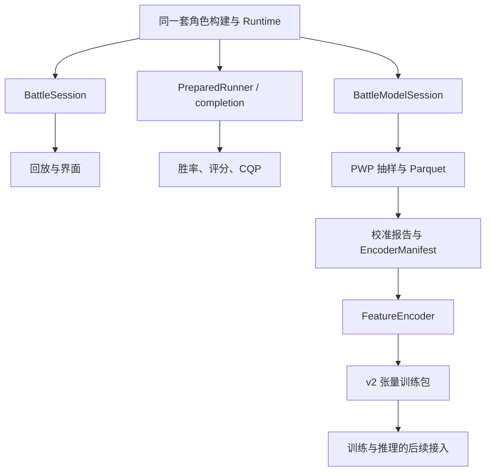
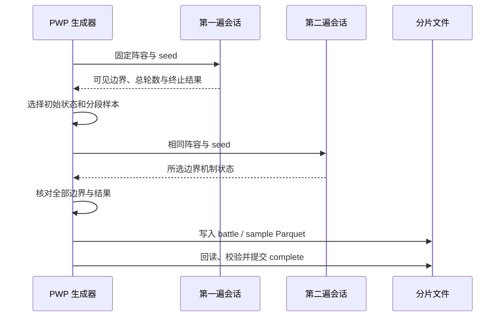

# 数据与批量计算：从重复对局到训练输入

[指南首页](README.md) · 上一篇：[交互与工具](interfaces-and-tools.md) · 下一篇：[开发与排查](contributing-and-debugging.md)

对局播放需要每一帧的文字和状态，胜率统计需要许多场的胜者，学习数据需要有来源和标签的机制状态。core 按这三种需要提供相应出口，业务工具再处理调度、文件和数据集。

## 三条计算路线



图：规则入口共享，捕获的数据各有侧重。当前 PWP 已完成从对局采样到编码训练包的链路，模型训练和推理可在这一基础上继续建设。

## PreparedRunner：同一阵容准备一次

`PreparedRuntimeRunner` 保存已构建阵容、默认规则配置和准备基线。每场按 seed 建立或复位本场随机、队伍排序、行动顺序和行动点，随后通过 completion runner 得到结果。

```rust
use tswn_core::{Runner, win_rate};

fn main() -> Result<(), Box<dyn std::error::Error>> {
    let groups = vec![vec!["left@red".into()], vec!["right@blue".into()]];
    let rq = tswn_core::namerena::eval_name::WIN_RATE_EVAL_RQ;
    let prepared = Runner::prepare_groups_with_eval_rq(&groups, rq)?;
    let summary = win_rate::prepared_win_rate(&prepared, 100, rq, 1)?;
    println!("{} / {}，胜率 {:.2}%", summary.wins, summary.total,
             summary.win_rate_percent());
    Ok(())
}
```

示例强制单线程便于观察。native `thread=0` 按平台和总局数选择 worker，WASM 使用单 worker。范围 API 按绝对局号派生 seed，便于分段任务保持采样身份。

### 复用怎样降低成本

| 阶段 | 可复用的内容 | 每场处理的内容 |
| --- | --- | --- |
| 角色准备 | 名字属性、技能、蓝图和配置 | seed 相关顺序及初值 |
| worker | runner、向量容量、派生缓存 | 本场状态复位 |
| completion | 机制与胜者统计 | 回合推进和终止计数 |
| 评分路径 | 注册配置与各类 scratch | 随轮次变化的数字 profile 名字与构建 |

completion 路径执行完整机制，以统计结果为出口。展示捕获通过专门的编译期路径选择，逐场 timing 则由 `_timed` API 提供。

## 胜率、profile 评分和组合评估

| 计算 | 问题 | 典型口径 |
| --- | --- | --- |
| win-rate | 第一输入组能赢多少场？ | `wins / total × 100` |
| profile score | 名字对生成的 profile 靶子表现怎样？ | `wins / total × 10000` |
| group / batch-rate | 同一选手对一组对手怎样？ | 平均胜率与汇总胜率分别保存 |
| factored targets | 不同靶子怎样带权重？ | 显式权重与有效对抗统计 |
| pair | 与多个队友组合时怎样？ | 筛选明细、Top 结果与配置指标 |

初始化、fight 耗时和错误/预算信息由相应 result/summary 保存。比较结果时按同一工具和参数解释数值，再根据需求选平均或合计指标。

## 学习状态保存什么

`BattleModelState` 在队列排空的回合边界导出已审计默认规则的机制信息：

- 世界顺序、输入队伍、运行时队伍和存活视图。
- 实体模板与当前 runtime，包括归属、守护、蓄力、聚气等。
- 技能当前/构建等级、强化、fixed lane、尝试顺序和 deferred 位置。
- 状态类型、载荷、优先级与注册游标。
- 已审计的模板槽、战斗槽、实体槽与蓝图。

身份以局内关系表示，例如阵营相等组；模型输入来自这些机制数据。名字文本、seed、未来胜者和采样审计分别留在对应的展示或数据记录中。继续复现相同随机未来时，使用原输入与 seed 重跑。

## PWP 怎样生成一局的样本



图：两遍执行让样本位置和最终结果有一致的复现依据。

初始状态单独保存，再按最终推进轮数划分采样区间，从区间内选可见帧并补足可用名额。已产生胜者的终局用于标签结果，过程样本保留对应的帧末机制。帧较少时，实际样本数自然较小。

### 标签与切分

| 字段 | 用途 |
| --- | --- |
| `state` | 模型的机制输入 |
| `winner_team_index` | 原输入队伍胜者标签，可空 |
| `frame` / `rounds_advanced` | 复现样本边界 |
| `progress` | 根据最终长度计算的采样审计值 |
| seed、battle_id、matchup_id、split | 对局身份、来源和数据集划分 |

监督标签使用输入队伍索引。预算或无进展截断保留样本并使用空胜者；Runtime failure 则进入生成错误处理，保存复现材料后结束本次生成。

阵容按规范化哈希分为 train/validation/test，比例目标为 80/10/10。同一阵容的 seed 和队伍排列变体使用同一切分组，小数据集会体现实际分布波动。

### 输出和恢复

```text
manifest.json
summary.json
shard-000000/
  battles.parquet
  samples.parquet
  complete.json
```

分片边界由对局编号范围决定。生成器先写临时目录，关闭文件后回读验证，再以完成标记提交；manifest、complete 与摘要共同支持 `--resume` 校验。输出目录使用进程文件锁，多个任务可以选择各自目录。

## 从 Parquet 到固定形状张量

| 步骤 | 产物 | 内容 |
| --- | --- | --- |
| `validate` | 完整性结果 | 摘要、行数、引用、标签和切分 |
| `stats` | 分布统计 | 状态族、规模、采样进度与容量 |
| `calibrate` | 校准报告 | train 有标签行的逐字段数值分布与常数 |
| `build-manifest` | EncoderManifest | 版本、容量、词表、归一化、证据与契约摘要 |
| `encode` | v2 训练包 | 分批 C 连续小端张量、标签与审计 |

`FeatureEncoder` 在 core 中保持唯一实现。初始化时校验 manifest，再将局内引用重映射为张量索引，按实体、模板、lane、列表、状态和槽等张量族编码。

### 容量与批布局

`baseline-64` 指定 `e/t/r/h/l/s/q/v/x` 九个容量维度，实体档位 `e_max=64` 是当前支持域选择。编码器在写入前检查引用和容量，超出时返回明确的 `CapacityExceeded`，便于选择合适档位或分析数据分布。

每个张量独立分配 `[B, ...]` 连续存储；mask 区分有效位置，引用 padding 使用 -1。复用批槽位先清理该槽，失败也恢复 padding，其他槽保留原内容。

| 导出通道 | 内容 | 消费方式 |
| --- | --- | --- |
| `features` | 模型张量与有效 mask | 数值模型输入 |
| `exact` | extra_bits、order_key 等精确旁路 | 按模型设计选择使用 |
| `labels` | winner_team_index 与 label_mask | 有标签样本监督 |
| `audit` | 来源行、对局、边界与 progress | 复现和质量分析 |

NumPy 读取器可以读取这些连续数组，并核对 shape、dtype、摘要与标签。详细格式见 [PWP README](../../crates/tswn_pwp/README.md) 和 [FeatureEncoder 规格](../design/feature-encoder-spec.md)。

## 其他批量工具怎样接入

Openbox 使用结构化任务、进度和预设组织 core 的 batch/pair/namer-pf。DS4 使用历史模型与缓存缩小候选集合，再按配置进入实战筛选。lane ranker 复用已保存的两两胜率矩阵，ladder 按匹配策略运行实际对局后更新评分。

各工具都能从明确输入、独立工作目录和可追溯配置中受益：机制由 core 统一，调度与结果用途由业务层表达。

## 源码入口

- [runtime/batch.rs](../../crates/tswn_core/src/runtime/batch.rs)、[cqp.rs](../../crates/tswn_core/src/runtime/cqp.rs)。
- [model_state.rs](../../crates/tswn_core/src/runtime/model_state.rs)、[BattleModelSession](../../crates/tswn_core/src/cli_api/battle/model_session.rs)。
- [encoder/](../../crates/tswn_core/src/encoder)、[PWP 实现](../../crates/tswn_pwp/src)。
- [设计索引](../design/README.md)、[编码包读取器](../../scripts/read_encoded_batches.py)。

---

[指南首页](README.md) · 上一篇：[交互与工具](interfaces-and-tools.md) · 下一篇：[开发与排查](contributing-and-debugging.md)
