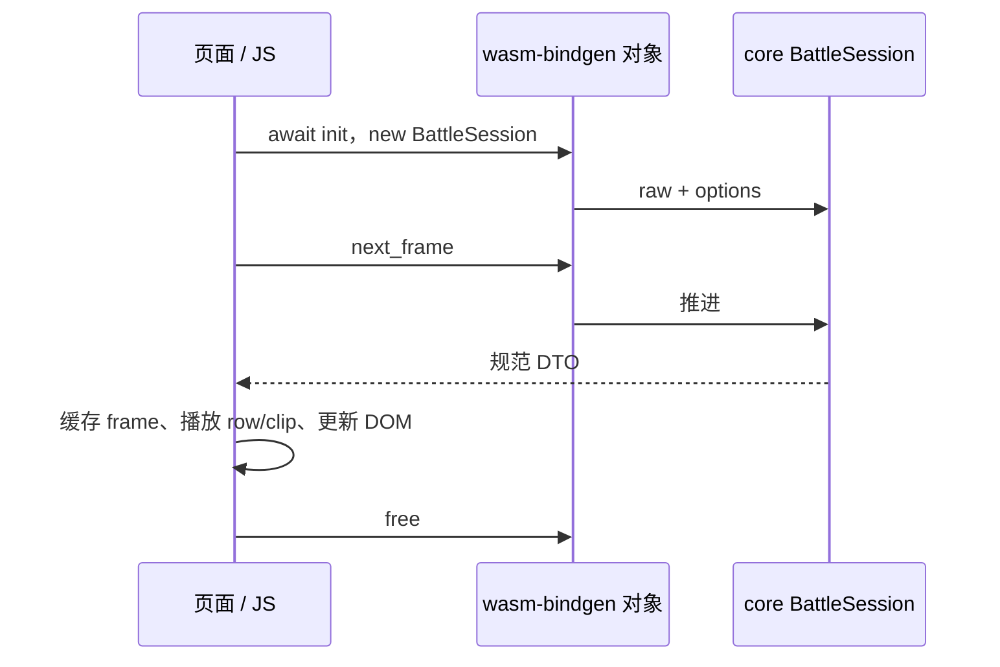

# 交互与工具：CLI、WASM、Python、C ABI 和业务应用

[指南首页](README.md) · 上一篇：[会话与回放](sessions-and-replay.md) · 下一篇：[数据与批量计算](datasets-and-extension.md)

交互层的共同目标是让宿主容易调用 core。选择接口时，先确定需要逐帧展示、批量统计、文件工作流还是常驻服务，再选择与场景匹配的包装。

## 接入方式总览

| 场景 | 入口 | 生命周期 | 主要输出 |
| --- | --- | --- | --- |
| Rust 应用 | core 公开 API | Rust 所有权 | 原生结构体与 Result |
| 命令行/管道 | tswn-cli | 一次进程 | 文本、JSONL、文件 |
| 浏览器/JS | tswn_wasm | init 后创建对象，finally free | JS DTO 与 `{ code, message }` 错误对象 |
| Python | tswn_py | Python 对象与异常 | dict/list、pyclass |
| C/C++ | tswn_capi | opaque 句柄与成对 free | 状态码、JSON、字节缓冲 |
| 本地面板/脚本化工具 | Openbox GUI / CLI | 后台任务与事件 | 增量视图、stdout、结果文件 |
| 筛号目录 | DS4 | 一次有缓存的流程 | 模型分数、配对与归档 |
| 排名服务 | lane ranker / ladder | 长期任务或周期轮次 | 数据库与审计 |

## CLI：从参数到输出

`tswn-cli` 的参数层统一原始文本、文件和子命令，然后进入对应执行模块。普通 fight 使用 BattleSession，工具命令复用 core 的构建和批量 API。

```powershell
cargo run -p tswn_core --bin tswn-cli -- fight -f target/repro.txt
cargo run -p tswn_core --bin tswn-cli -- fight --jsonl -f target/repro.txt
cargo run -p tswn_core --bin tswn-cli -- bench win-rate -f target/repro.txt -n 100
cargo run -p tswn_core --bin tswn-cli -- to-diy -r "alice@red"
```

`fight --jsonl` 每行输出一个规范 envelope，并及时 flush：

```json
{"type":"initial","data":[...]}
{"type":"frame","data":{...}}
{"type":"result","data":{...}}
```

以上是结构示意。机器读取逐行解析 `type` 和 `data`；错误走 stderr，进程以非零状态结束。普通交互 fight 可以输出欢迎信息和文本，JSONL 模式保持结构化 stdout。

各 bench / pair 输入还可能使用“一行一组”的列表格式、`+` / `++` 分隔和带权 TOML。完整参数见 [core README](../../crates/tswn_core/README.md)。

## WASM：宿主调用与页面播放



图：WASM 负责计算与转换，页面负责主题、昵称、播放游标和渲染。

```javascript
import init, { BattleSession } from "./tswn_wasm.js";
await init();
const session = new BattleSession("left@red\n\nright@blue");
try {
  for (let frame; (frame = session.next_frame()) !== null;) {
    console.log(frame.frame_index, frame.states);
  }
  console.log(session.result());
} finally {
  session.free();
}
```

示例把绑定模块放在当前目录；实际分发路径按 [WASM README](../../crates/tswn_wasm/README.md) 配置。`BattleSession` 返回规范 DTO，`FightSession` 保留旧页面字段投影，新接入从规范接口开始最直接。

`WinRateSession.step(batch_size)` 让应用分批计算并报告进度。每次调用是同步的，页面在批次间让出事件循环或自行放入 Web Worker；当前 WASM 胜率运行单 worker。

页面模块按职责组织：入口、播放推进、主题交互、详情、数据源、快照规划和 renderer。Dark Reader 检测、深浅色和护盾条都在展示层，原始战斗数据继续由 core 提供。

## Python：脚本中的规范会话

```python
import tswn_py

session = tswn_py.BattleSession("left@red\n\nright@blue")
for frame in session:
    print(frame["round_index"], frame["updates"])
result = session.result()
```

BattleSession 是可迭代对象，frame 与 result 经规范 DTO 转成 dict/list。评分、胜率、格式转换等高层 helper 直接注册在 `tswn_py` 顶层（例如 `tswn_py.score`）；`cli_api` 是 Rust 内部模块，不是可导入的 Python 子模块。Runner/PreparedRunner pyclass 支持高级机制和重复阵容计算。

Python 异常携带对应 code，Runtime failure 由 `is_failed` 查询。Python 包的 `.pyi` 提供宿主签名，Cargo doc 提供 Rust 适配结构；安装和示例见 [Python README](../../crates/tswn_py/README.md)。

## C ABI：显式所有权

| 阶段 | 调用方的工作 |
| --- | --- |
| 检查版本 | 查询包装版本、core 版本与 ABI 版本 |
| 初始化 | default options，传入有效 UTF-8，得到 session 句柄 |
| 读取帧 | 检查 status 与 has，读取 len 字节 JSON |
| 释放帧 | 对返回的 `tswn_str_t` 调用 `tswn_str_free` |
| 读取结果 | 正常结束后按 has 读取结果 |
| 清理会话 | 调用对应 `tswn_battle_session_free` |

当前 ABI 为 4。options 通过 `struct_size` 保持历史前缀兼容，默认初始化函数提供正确尺寸。`tswn_last_error_code/message` 返回线程局部错误信息的拥有型字符串，也按字符串生命周期释放。

调用方在清理路径成对释放字符串、字节和句柄，使用同一份库的分配器，并在一个执行上下文中推进同一会话。完整可编译示例见 [battle_session.c](../../crates/tswn_capi/examples/battle_session.c)，构建链接见 [C ABI README](../../crates/tswn_capi/README.md)。

## Openbox：业务任务与增量结果

GUI 与 `openbox-cli` 共享 `tswn_openbox_backend`，覆盖 DIY、namer-pf、批量胜率和 pair。GUI 后台计算产生进度和结构化结果，界面通过有界收件箱消费；输出文件保留业务结果。

openbox-cli 数据行输出到 stdout，进度与状态输出到 stderr，适合重定向与脚本。预设来自工作目录的 `setting/`，首次需要时释放内嵌资源。DS4 页面直接调用 DS4 library，DS4 实战筛选再调用共用后端，形成清晰的依赖方向。

详见 [Openbox README](../../crates/tswn_openbox/README.md)。

## DS4 与排名服务的交互

| 工具 | 工作方式 | 主要外部资源 |
| --- | --- | --- |
| DS4 | 读取目录配置、增量处理输入、调用模型并归档 | 工作目录与可选 ABCP5 文件/模型 |
| lane ranker | Axum 接口编排后台排名、校准与靶子任务 | SQLite、Python 数值环境 |
| ladder | 按 cron 或单轮匹配、战斗、更新与回写 | PostgreSQL 和排名日志目录 |
| name ranker | 独立单号排名服务 | 独立校准 JSON/TSV 与 SQLite |

这些工具通过文件和数据库保存长期结果。试运行使用独立工作目录或测试数据库，就能保留完整输入、配置和审计过程。

## 继续查阅

- [公共 API 契约](../reference/public-api.md)、[构建与打包](../guides/build-all.md)。
- [DS4](../../crates/tswn_ds4/README.md)、[lane ranker](../../crates/tswn_lane_ranker/README.md)、[ladder](../../crates/tswn_ladder/README.md)。
- [网页模块说明](../../crates/tswn_wasm/examples/README.md)、[脚本验证入口](../../scripts/README.md)。

---

[指南首页](README.md) · 上一篇：[会话与回放](sessions-and-replay.md) · 下一篇：[数据与批量计算](datasets-and-extension.md)
