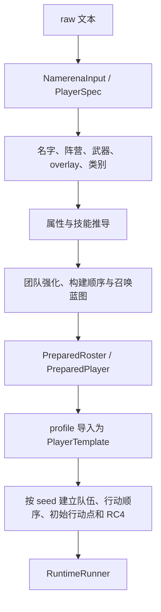

# 从名字到角色：输入解析、构建与本场初始化

[指南首页](README.md) · 上一篇：[项目地图](project-map.md) · 下一篇：[运行时模型](runtime-model.md)

在游戏中，你看到一个名字就会关心它的八围、技能、武器和队友加成。在 core 中，这个过程分成“解析文本”“构建角色”“按本场 seed 初始化”三步。把它们分开，既容易研究单个名字，也方便对同一阵容运行很多场战斗。

## 文本里的三种关系

```text
alice@red
bob@red

carol@blue
seed:demo@!
```

| 写法 | 表达什么 | 对本例的影响 |
| --- | --- | --- |
| 连续角色行 + 空行 | 对战分组 | alice、bob 在输入队伍 0，carol 在队伍 1 |
| `name@clan` | 名字的阵营/队名信息 | red、blue 参与名字构建和相关机制 |
| `seed:` 行 | 本场初始化材料 | `seed:demo@!` 被提取为 seed |

有空行时，连续行作为一组；全部角色行连续且没有空行时，每行各自组成一组。队伍分组、名字阵营和本场运行时 team 分别承担不同职责，后续输出会保留它们的映射。

单个角色通常写成 `name@clan+weapon`。后缀也可以包含 `ol:{...}` 或 `diy[...]`。解析器在引号外拆分 `+`，因此 JSON 字符串中的 `+` 可以保留自己的含义。

## 完整构建链路



图：输入数据逐步成为一场战斗。普通 raw 构造还会经过 Runtime 的准备初始化路径，以保存兼容的 seed 行与排序语义；`namerena` 类型提供清晰的构建数据入口。

## 身份名为什么有好几个

| 数据 | 用途 |
| --- | --- |
| `raw` | 保存用户完整输入，包括武器或覆盖后缀 |
| `name` / `clan_name` | 名字本体与阵营信息 |
| `id_key_name` | 用于身份推导、排序和图标的键 |
| `display_name` | 面向人类的展示文字 |
| 实体 ID | 本场战斗中的关系和事件主键 |

`raw_namerena_to_id_name` 按兼容规则整理身份，武器/overlay 后缀留在构建参数中。同名角色、分身和召唤物可以拥有不同实体 ID，界面通过 ID 关联状态，昵称通过展示层修改。

## 名字怎样决定属性和技能

构建过程通过与原实现对齐的 RC4 处理名字和阵营材料，产生名字基础数据、八围与技能顺序，再叠加相应规则。`PreparedPlayer` 保存这些派生结果，供 Runtime 导入使用。

| 数据 | 典型作用 |
| --- | --- |
| `attrs` | 八围基础数据 |
| `PlayerStats` | 构建后的体力、攻防、速度、敏捷、魔法、抗性、智慧等 |
| `SkillLoadoutSpec` | 技能、等级、强化与尝试顺序 |
| `weapon_attr_bonus` | 武器带来的属性修正 |
| `name_factor` | 名字评估得到的缩放因子 |
| `clone_*` 数据 | 分身派生需要保留的构造信息 |

构建依赖组合信息。团队强化与座位相关技能修正会改变导入结果，批量准备应以完整阵容为单位。

### `eval_rq` 与 name_factor

`eval_name` 按 UTF-16 码元统计字符类别、变化和空格，得到名字常见度相关结果，并通过构建规则影响 `name_factor`。输入长度检查使用 UTF-8 字节，两种计数服务于不同目标。

当前默认参数：

| 场景 | `eval_rq` |
| --- | --- |
| 普通 fight / BattleSession | `DEFAULT_EVAL_RQ = 4.0` |
| 默认胜率评估 | `WIN_RATE_EVAL_RQ = 6.0` |

这是角色构建参数。同一个 `PreparedRunner` 会保存所用口径；换口径时重新准备阵容，就能得到一致的构建结果。

## 用 OL 显式观察机制

```text
left@red+ol:{"skills":{"shield":80}}

right@blue+ol:{"skills":{}}
seed:7@!
```

本例保留名字派生属性，显式指定左侧护盾技能熟练度为 80，右侧采用空的显式技能配置。它很适合观察行动前蓄盾和受击吸收。

| 覆盖项 | 使用方式 |
| --- | --- |
| `attrs` | 指定 `[atk, def, spd, agi, mag, res, wis, maxhp]` |
| `skills` | 指定有序的技能等级/强化列表 |
| `name_factor_enabled` | 选择名字系数缩放口径 |
| `shadow` / `summon` / `zombie` | 分别指定幻影、使魔与丧尸的蓝图覆盖 |
| `weapon` | 在普通名字推导口径下覆盖武器 |

带属性或技能覆盖的 DIY 口径使用专门的武器处理规则。`diy[...]` 和 OL 的前七围都按 `(value - 36).max(0)` 解码，HP 保持原值；导出时按相应编码还原。完整字段和往返示例见 [DIY / OL 参考](../reference/diy-overlay.md)。

## Boss、特殊名字与蓝图

`PlayerClass` 在解析阶段区分普通、Boss、Boost 和评分用特殊类别。Boss 名配合相应 `@!` 形式进入特殊规则，profile 在导入时设置种类、标记、策略和专用状态。

召唤物蓝图是“将来生成时的构造资料”。蓝图保存属性、技能和重施策略；实体槽可以按需保存或延迟构建蓝图。真正生成时，Runtime 分配/使用实体 ID、绑定 owner、加入世界视图，随后参与战斗。

## 动手查看

```powershell
cargo run -p tswn_core --bin tswn-cli -- to-diy -r "alice@red"
cargo run -p tswn_core --bin tswn-cli -- to-diy -r "alice@red" --minions
```

这两条命令把角色构建结果转换为可阅读、可再次输入的覆盖形式。命令细节见 [core README](../../crates/tswn_core/README.md)。

## 源码入口

- [input.rs](../../crates/tswn_core/src/namerena/input.rs)：文本、单号与身份解析。
- [build.rs](../../crates/tswn_core/src/namerena/build.rs)：属性、技能、团队强化与蓝图。
- [eval_name.rs](../../crates/tswn_core/src/namerena/eval_name.rs)：字符评估和 rq 常量。
- [profile/import.rs](../../crates/tswn_core/src/runtime/profile/import.rs)：构建数据导入运行时。
- [prepared_init/](../../crates/tswn_core/src/runtime/prepared_init)：本场排序、seed 与初始状态。

---

[指南首页](README.md) · 上一篇：[项目地图](project-map.md) · 下一篇：[运行时模型](runtime-model.md)
