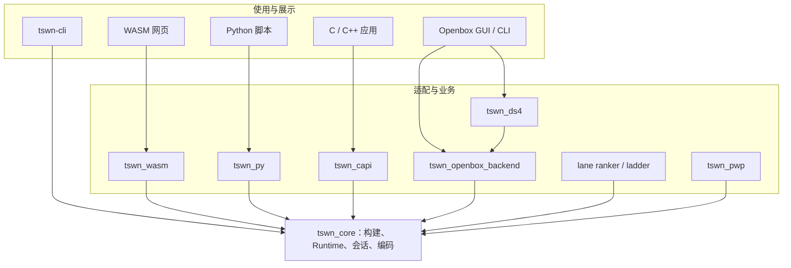

# 项目地图：规则、接口与工具怎样组成 tswn

[指南首页](README.md) · 上一篇：[指南导读](README.md) · 下一篇：[从名字到角色](name-to-player.md)

tswn 把 namerena 的角色构建和战斗机制实现为 Rust 核心，再围绕核心组织语言绑定、交互界面、批量评估、排名和学习数据工具。理解项目时，最有用的划分是“规则在哪里”“谁调用规则”“结果保存在哪里”。

## 三层结构

图：调用方向示意。线条表达主要职责链路；完整 Cargo 依赖以各 crate 的 Cargo.toml 为准。

同一份名字与参数经过同一套 core 规则执行。包装层负责把调用方式和结果形式转换为宿主容易使用的接口：终端文本、Python 对象、C 句柄、JavaScript DTO 或 GUI 任务事件。

## 各 crate 的角色

| crate | 核心职责 | 面向谁 | 主要输入 / 输出 |
| --- | --- | --- | --- |
| `tswn_core` | 名字构建、战斗、会话、胜率/评分、图标、特征编码 | 所有应用和机制开发者 | raw 文本 / 结构化模板 → 结果、帧、状态或张量 |
| `tswn_wasm` | WASM 导出、JS 转换、TypeScript 声明 | 浏览器与 JS 调用者 | JS 参数 → DTO、图标、步进会话 |
| `tswn_py` | PyO3 扩展和 Python 类型声明 | Python 脚本 | Python 参数 → dict/list、pyclass、异常 |
| `tswn_capi` | 动态库/静态库 C ABI | C/C++ 与其他 FFI 宿主 | UTF-8、句柄 → 状态码、JSON、缓冲 |
| `tswn_openbox` | GUI 与 openbox-cli | 本地交互用户 | 面板/参数 → 日志、结构化视图、文件 |
| `tswn_openbox_backend` | 共用业务计算、进度、结果、预设 | GUI、CLI、DS4 | 任务结构 → 增量结果和文件 |
| `tswn_ds4` | 单人/配对模型、ABCP5 编排、实战筛选、缓存 | 筛号工作流 | 工作目录 → 排序与历史结果 |
| `tswn_lane_ranker` | lane 两两胜率、迭代排名、校准和管理服务 | 内部排名工具 | SQLite / HTTP → 排名与审计 |
| `tswn_ladder` | 匹配、战斗、ELO/handicap 和周期更新 | 天梯运营 | PostgreSQL → 回写与历史 |
| `tswn_pwp` | 状态采样、分片校验、校准、训练包导出 | 学习数据处理 | 对局输入 → Parquet / 编码包 |
| `tswn_test` | 共享行为测试和 golden/corpus 验收 | 项目开发者 | 固定输入 → 行为差分 |
| `tswn_name_ranker` | 独立单号排名与校准服务 | 内部单号研究 | 专用资源 / SQLite → 排名 |

前十一项是根 workspace 成员；`tswn_name_ranker` 使用独立校准资源，通过根 Cargo.toml 的 `exclude` 单独管理。

## core 内部也有三种关注点

| 关注点 | 模块 | 问题 |
| --- | --- | --- |
| 静态输入和构建 | `namerena`、`rc4` | 名字怎样成为属性、技能、武器和身份？ |
| 正在执行的机制 | `runtime` | 谁行动、技能何时触发、状态和召唤如何变化？ |
| 对外使用与数据 | `cli_api`、`replay_view`、`win_rate`、`encoder` | 应用需要哪种结果和数据粒度？ |

**一个游戏概念可能跨越多层。** 例如护盾：名字构建产生技能等级；Runtime 行动前蓄盾、受击时吸收；快照导出实际盾值和当前熟练度；网页按盾值变化显示盾条；HP 与盾同时变化时，盾条叠在 HP 底轨正上方，只有盾变化时独占条形槽位。

## 同样叫“评分”，计算来源可以不同

- core 的胜率和 profile 评分通过实际战斗统计得到。
- lane ranker 与 ladder 在战斗结果之上使用各自排名策略。
- DS4 包含已有系数模型，以及对外部 ABCP5 的调用；实战筛选再交给 core。
- PWP 已提供数据与编码链路，模型训练、推理和在线接入是接下来的独立工作。

因此，比较数值时要同时记录工具、口径、输入、`eval_rq`、局数、seed 范围和模型/校准资源。

## 仓库目录的用途

| 目录 | 怎样使用 |
| --- | --- |
| `crates/` | 查实现、crate README 和 CHANGELOG |
| `docs/` | 查原理、指南、契约、设计、性能和历史 |
| `scripts/` | 构建打包、跨语言验收、差分和数据读取 |
| `tests/` | 复现输入与差分样例 |
| `crates/tswn_test/cases/` | 阅读已冻结的行为基线 |
| `assets/` | 公共资源 |
| `target/` | 本机编译、分析、数据集和临时产物 |

## 源码入口

- [根 workspace](../../Cargo.toml)：成员、排除项与构建 profile。
- [core 库入口](../../crates/tswn_core/src/lib.rs)：公开模块与 Runner 别名。
- [开发指南](../guides/development.md)：修改归属与验收范围。
- 各工具的运行参数从对应 [crate README](../../README.md#文档入口) 继续查阅。

---

[指南首页](README.md) · 上一篇：[指南导读](README.md) · 下一篇：[从名字到角色](name-to-player.md)
