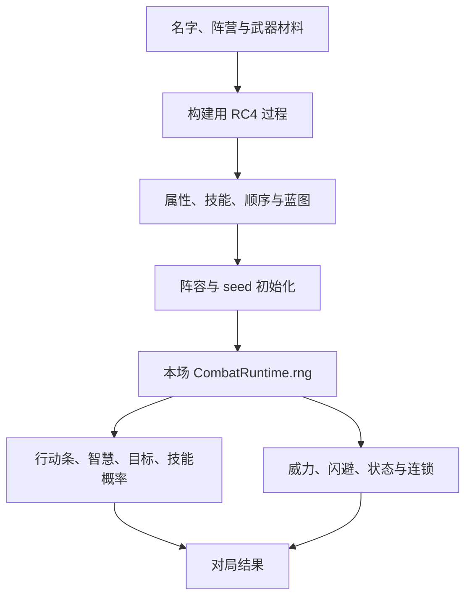
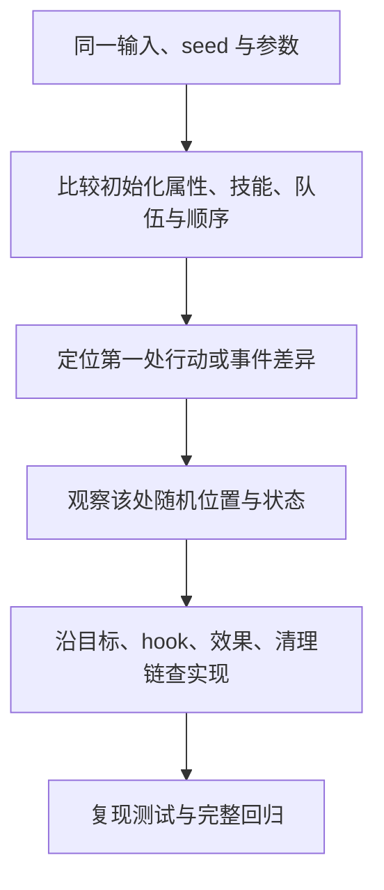

# 随机与兼容：怎样复现同一场战斗

[指南首页](README.md) · 上一篇：[状态与召唤物](statuses-and-minions.md) · 下一篇：[会话与回放](sessions-and-replay.md)

名字竞技场的乐趣来自确定性名字与随机战斗的组合。core 把随机过程写成可追踪的序列，使固定输入、参数和版本下的对局可以复现，也能与原 JS 行为逐步对照。

## 随机流怎样贯穿项目



图：构建随机过程和本场战斗随机流各有状态，二者共同决定可复现结果。数据抽样、任务匹配或天梯扰动还会有各工具自己的随机来源。

## RC4 在这里的用途

`RC4` 保存 256 字节状态排列及 `i`、`j` 游标，提供字节、范围、概率、选取和排序等兼容方法。它在项目中承担游戏随机协议；安全相关的新功能应选择适合安全用途的方案。

| 方法族 | 用途 | 观察重点 |
| --- | --- | --- |
| `next_u8` | 消费一个随机字节 | 调用时机与字节序列 |
| `r127` / `r63` 等 | 掩码型范围值 | 0 起始的端点 |
| `r256` / `r64` 等 | 1 起始的范围值 | 同一字节的不同数值解释 |
| `next_i32(max)` | 兼容范围选择 | max 与具体采样方法 |
| `c50` 等 | 概率判断 | 阈值、比较符和消费次数 |
| `pick` / `sort_list` | 目标或顺序选择 | 候选列表与随机消费 |

两个表达式即使看起来概率接近，也可能在端点或消费数量上不同。行为对齐时，保留原来的随机方法和调用顺序，最容易让后续整条链一致。

### 为什么多读一个随机字节影响很大

一个字节可能决定本次智慧，下一个决定技能，再下一个决定威力。中间改变消费次数后，后续过程会读取原先属于其他决策的字节，因此差异会扩散。

纯查询的状态投影适合反复读取：玩家快照、规范机制状态和显示处理各自从当前数据提取信息。诊断随机流时，游标用于观察位置，完整状态排列用于区分相同游标下的不同状态。

## 复现输入应记录什么

| 材料 | 记录理由 |
| --- | --- |
| 完整 raw 文本 | 保留组间空行、武器、OL 和特殊后缀 |
| seed 行及顺序 | 保留本场初始化材料 |
| `eval_rq` | 保留角色构建口径 |
| core 版本或 commit | 保留实际规则与数值实现 |
| 包装层版本 | 保留接口转换与展示实现 |
| 最大回合数 | 区分完整胜利和预算截断 |
| 自定义 registry / 模板配置 | 保留扩展规则与蓝图来源 |
| 外部模型或校准摘要 | 保留 DS4、排名或编码口径 |

命令建议使用文件保存多行输入：

```powershell
@'
left@red

right@blue
seed:demo@!
'@ | Set-Content -Encoding utf8 target/repro.txt

cargo run -p tswn_core --bin tswn-cli -- fight -f target/repro.txt
cargo run -p tswn_core --bin tswn-cli -- runtime normalized-run -f target/repro.txt
```

文件适合保留精确分组和换行；在 PowerShell 中输入带 `\n` 的普通字符串时，按 shell 的实际转义语义组织内容。

## JS 兼容的几个细节

- 字符评估按 UTF-16 码元进行，输入字节长度另有 UTF-8 校验。
- 行末处理采用对应的 JS trim 语义；名字本体、阵营和 JSON 字符串分别处理。
- 比较的严格/包含端点、整数除法与浮点 `ceil` 会影响具体结果。
- 分身等构造保留相应浮点字面量与 bits，便于重现原数值。
- 原游戏的技能顺序、状态注册序、预留 ID 和世界 roster 共同参与连锁。

旧 Dart 源码提供实现背景，当前行为对齐优先参考实际 JS 产物与已记录 case。这样能把历史结构和本次运行证据结合起来。

## 如何阅读差分



图：由输入向第一处分叉靠近。比较完整文本很直观；normalized outcome、action boundary 和 RNG checkpoint 能把观察点进一步定位到机制阶段。

`tswn_test` 的 golden/corpus 保存冻结行为证据。局部机制验证帮助确认具体修复，完整 corpus 检查跨技能、召唤和 Boss 链路。开发工具还能保存失败集 checkpoint，观察差异位置如何变化。

## 批量战斗中的确定性

胜率范围任务按绝对局号派生 profile seed。每个 worker 复用自己的 runner，并根据局号复位；任务分段仍保留同一场采样身份。评分路径的数字 profile 名字会随轮次变化，使用相应的专门构建/复位流程。

PWP 另外将阵容、seed 派生、采样和分片写入 manifest，再用两遍执行核对边界与结果。详细数据协议见 [数据与批量计算](datasets-and-extension.md)。

## 源码入口

- [rc4.rs](../../crates/tswn_core/src/rc4.rs)、[eval_name.rs](../../crates/tswn_core/src/namerena/eval_name.rs)。
- [prepared_init/](../../crates/tswn_core/src/runtime/prepared_init)：初始化与 seed。
- [normalized.rs](../../crates/tswn_core/src/runtime/normalized.rs)、[trace.rs](../../crates/tswn_core/src/runtime/trace.rs)。
- [batch.rs](../../crates/tswn_core/src/runtime/batch.rs)：局号与复用执行。
- [测试框架](../../crates/tswn_test/src/lib.rs)、[差分文档](../diff/README.md)。

---

[指南首页](README.md) · 上一篇：[状态与召唤物](statuses-and-minions.md) · 下一篇：[会话与回放](sessions-and-replay.md)
