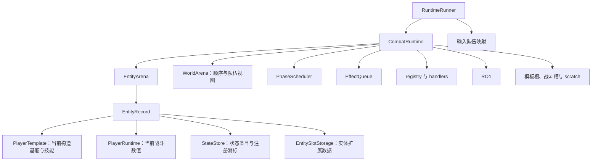

# 运行时模型：一场战斗保存了哪些信息

[指南首页](README.md) · 上一篇：[角色构建](name-to-player.md) · 下一篇：[战斗流程](battle-flow.md)

Runtime 可以理解为“一场战斗的工作台”。角色数据、队伍关系、行动顺序、随机流、待提交效果和扩展配置都在这里集合。`RuntimeRunner` 负责把这张工作台变成方便构造和推进的对局入口。

## 谁拥有数据

图：数据拥有关系。handler 通过借用上下文读取或修改这些数据，执行完回到同一工作台。

## 模板与当前值如何配合

| 数据层 | 保存什么 | 举例 |
| --- | --- | --- |
| `PlayerTemplate` | 当前构造基底、身份、技能、分身资料与策略覆盖 | max HP、导入技能、召唤构造参数 |
| `PlayerRuntime` | 本场当前值和专用机制状态 | HP、MP、有效攻防、行动点、蓄盾、守护关系 |
| `StateStore` | 通用状态载荷、hook 和顺序数据 | 中毒来源/次数、冰冻步数、加速有效倍率 |
| 实体槽 | 注册的额外数据 | 蓝图、已生成召唤物、生成计数 |

模板提供重新计算有效属性的基底，运行时保存这一刻的有效值。吞噬会修改模板属性或技能，分身会沿派生数据衰减，因此“模板”表示结构角色而非永远冻结的初值。

初始等级与当前等级分别存储在 `build_levels` 和 `levels`。例如盾条上限读取当前护盾熟练度，吞噬后的下一快照就可以呈现新的上限。

## 实体 ID 的几个层次

| 名称 | 含义 | 使用位置 |
| --- | --- | --- |
| `EntityIdx` | arena 的稳定 u32 索引 | 机制中的 owner、target、world 列表 |
| `PlrId` / DTO `id` | 对外实体数值标识 | 消息、快照、绑定调用 |
| `PlayerTemplate.id` | 构造资料中的 ID | 模板构造与导入 |
| `display_name` / `display_index` | 面向读者的名称和序号 | 分身区分、界面文本 |

普通输入构造会建立相应映射；低层模板可以携带自定义构造 ID。处理战斗快照时，以该快照的 `id` 作为主键最直接。

arena 为生成兼容保留 ID 空槽，现有实体列表可以稀疏。`entity_slot_count` 表示包括空槽的容量身份范围，实际 `entities` 列表只列已经存在的实体。

## 世界视图为什么保存好几个列表

| 视图 | 问题 | 死亡后的角色 |
| --- | --- | --- |
| `round_order` | 当前按什么顺序轮询？ | 兼容调度保留相应顺序信息 |
| `team_roster` | 这一队有哪些登记实体？ | 可继续保留成员身份 |
| `team_alive` | 这一队现在有哪些存活实体？ | 随生命周期更新 |
| `flat_alive` | 全场有哪些存活实体？ | 用于目标与胜负视图 |
| `input_groups` | 用户原输入怎样成队？ | 由 runner 保存来源映射 |

死亡、复活、召唤、移除和魅惑各有生命周期入口，会协调实体本体与这些索引。数据导出时，运行时 `team` 描述当前机制，`input_team_index` 描述来源，学习标签使用来源队伍索引。

## 状态登记有两条信息线

一条线记录状态类别和实际载荷，另一条线记录“何时加入本场状态链”。`legacy_order_key` 用于兼容的状态类别识别，`runtime_registration_order` 与注册游标用于同一行动中的先后关系。

Shield、Protect、Upgrade、Corpse、Minion 中有些机制压缩为标记或专用 runtime 字段。登记时它们仍占用状态注册位置，吞噬新增技能可以据此插入恰当阶段。

## 三种扩展槽

| 槽 | 作用域 | 推荐用途 |
| --- | --- | --- |
| `TemplateSlotStorage` | 准备配置 | 共享构造模板 |
| `BattleSlotStorage` | 一局 | 全局机制数据 |
| `EntitySlotStorage` | 一个实体 | 蓝图、引用和计数 |

注册表先分配槽 ID，storage 按同一注册表建立。`SlotValue` 提供 Bool、整数、文本和 PlayerTemplate 等明确种类。handler 的跨实体与槽访问通过相应 capability 获得权限。

## 可复用对局怎样恢复

`PreparedRuntimeRunner` 保存准备基线和阵容材料。每个 worker 可以创建可复用 runner，再用新的 seed 复位本场：

1. 恢复实体、技能、状态和槽的基线。
2. 清理本场效果、世界与临时 scratch。
3. 按 seed 更新队伍排序、行动顺序和初始行动点。
4. 建立本场 RC4，开始下一局。

dirty 标记、generation 和缓存用来减少重复分配与无变化复位。它们服务于相同的机制结果，研究状态含义时优先看模板、runtime、载荷与顺序。

## 四种状态出口

| 出口 | 最适合做什么 |
| --- | --- |
| 完整 `CombatRuntime` | 研究与执行机制 |
| `RuntimePlayerSnapshot` / `BattlePlayerState` | 展示角色当前值和人类可读标签 |
| `BattleModelState` | 在已审计回合边界保存学习所需机制 |
| `EncodedBatch` | 向数值模型提供张量、mask 与精确旁路 |

## 源码入口

- [runner.rs](../../crates/tswn_core/src/runtime/runner.rs)、[combat/mod.rs](../../crates/tswn_core/src/runtime/combat/mod.rs)。
- [entity.rs](../../crates/tswn_core/src/runtime/entity.rs) 与 [entity/runtime.rs](../../crates/tswn_core/src/runtime/entity/runtime.rs)。
- [world.rs](../../crates/tswn_core/src/runtime/world.rs)、[slot.rs](../../crates/tswn_core/src/runtime/slot.rs)。
- [state/store.rs](../../crates/tswn_core/src/runtime/entity/state/store.rs)、[skill_loadout.rs](../../crates/tswn_core/src/runtime/entity/skill_loadout.rs)。

---

[指南首页](README.md) · 上一篇：[角色构建](name-to-player.md) · 下一篇：[战斗流程](battle-flow.md)
