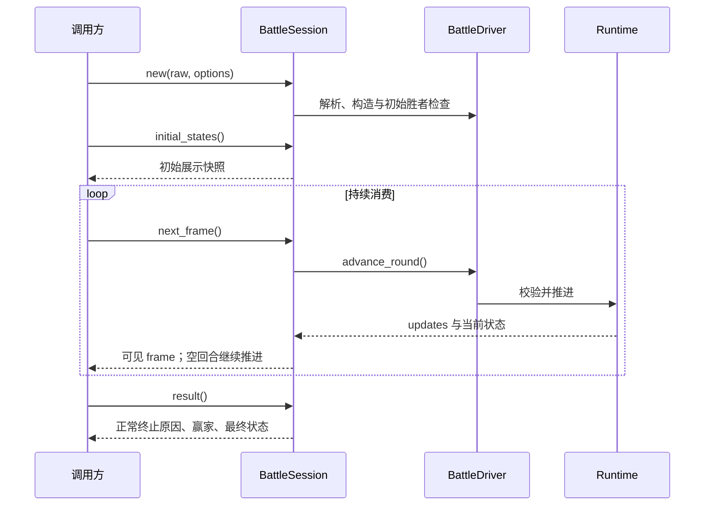
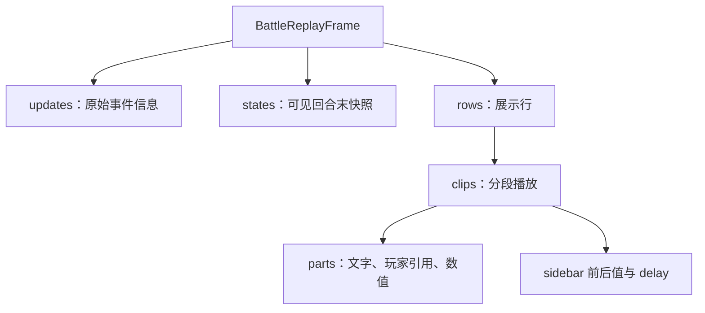

# 会话与回放：把机制推进交给 core，把播放交给应用

[指南首页](README.md) · 上一篇：[随机与兼容](randomness-and-compatibility.md) · 下一篇：[交互与工具](interfaces-and-tools.md)

`BattleSession` 是最适合应用接入的对局入口。它组合 Runtime、输入校验、回合预算、终止决策、当前快照和回放投影。调用方只需读取初始状态、持续取帧，再消费终止结果。

## 一套推进策略，三种使用方式

| 入口 | 适合场景 | 产物 |
| --- | --- | --- |
| `BattleSession` | 网页、脚本、终端逐帧消费 | 展示快照、消息、rows/clips 和结果 |
| `battle_replay` | 需要整场回放的调用 | 收集同一会话得到的完整对象 |
| `BattleModelSession` | 数据生成、机制观察 | 可见边界与机制状态 |

前两者面向展示，第三者面向学习数据；两种 session 使用同一个 `BattleDriver` 的推进和终止逻辑。

## 一次调用的生命周期



图：会话负责机制，调用方负责消费和显示。查询快照或结果自身保持对局位置。

## 可复制的 Rust 示例

```rust
use tswn_core::cli_api::battle::{BattleOptions, BattleSession};

fn main() -> Result<(), Box<dyn std::error::Error>> {
    let raw = "left@red\n\nright@blue\nseed:demo@!";
    let mut session = BattleSession::new(raw, BattleOptions::default())?;
    println!("初始角色：{}", session.initial_states().len());
    while let Some(frame) = session.next_frame()? {
        println!("帧 {} / 回合 {}", frame.frame_index, frame.round_index);
        for update in frame.updates {
            println!("{}", update.message_rendered);
        }
    }
    let result = session.result().expect("正常终止有结果");
    println!("原因：{:?}", result.stop_reason);
    Ok(())
}
```

对应示例在 core 的 Cargo doc 中验证；实际字段可以从 [DTO 定义](../../crates/tswn_core/src/cli_api/battle/dto.rs) 查阅。

## 正常终止与失败各怎样观察

| 情况 | `status()` | `is_done()` | `is_failed()` | `result()` |
| --- | --- | --- | --- | --- |
| 正在运行 | running | false | false | None |
| 存在胜者 | finished | true | false | 正常赢家结果 |
| 安全预算/无进展截断 | truncated | true | false | 截断结果 |
| Runtime 失败 | running | false | true | None |

正常终止后的 `next_frame` 返回 None；失败后的推进返回首次保存的错误。错误分类和说明由 `CliApiError` 提供，绑定再转换为 Python 异常、含 `code/message` 的 JS 错误对象或 C 状态码。

推荐消费方式是：推进遇到错误就结束本次会话并展示失败说明；正常读到 None 后取 result，按 stop_reason 显示胜利或截断。

## 数据粒度从 frame 到文字片段



图：一份机制结果可以分成多个播放片段。动画所需的时间和局部变化由回放投影整理。

| 数据 | 使用建议 |
| --- | --- |
| `frame_index` | 跟踪已产出可见帧，从 0 开始 |
| `round_index` | 跟踪 Runtime 推进位置，从 0 开始 |
| `states` | 更新帧末角色面板 |
| `updates` | 事件分析、日志或兼容消息处理 |
| `rows` / `clips` / `parts` | 直接按结构播放，关联 player_id |
| `sidebar_previous_states` / `sidebar_states` | 片段展示中的前后值 |
| `delay` / `total_delay` | 毫秒级显示节奏 |

帧末快照提供当前显示属性，片段值提供播放顺序中的 HP/盾变化。完整机制分析使用回合边界的 Runtime 或 BattleModelState，就能同时拿到状态载荷、技能顺序和实体关系。

## 玩家快照如何理解

身份和关系：`id`、`input_team_index`、`team_index`、`owner_id`、`source_id`。

显示：`display_name`、`display_index`、`icon_key`、可选 PNG Base64。

当前数值：HP/max HP、shield/max shield、MP、行动点和各项有效属性。

状态：alive、active、frozen 与人类可读 `status_labels`。

面板以实体 ID 维护映射；胜者来源队伍使用 `winner_team_indices`。这让召唤、魅惑、同名和分身各有合适的表示。

## 网页播放游标与机制位置

网页可以缓存已经生成的 frame，按 row/clip 设置显示游标，支持暂停、单步、回看和检查点恢复。回看读取历史数据；按需播放再请求下一 frame；重新运行则创建新的 BattleSession。

前端检查点保存的是显示重建所需数据。可见帧的批次与动画片段的时间线相互配合，就能在浏览器中维持清晰的当前面板与历史文字。

## 选项与成本

| 选项 | 默认值 | 成本或意义 |
| --- | --- | --- |
| `eval_rq` | 4.0 | 固定普通名字构建口径 |
| `include_icons` | false | 需要图标时计算并缓存 Base64 |
| `max_rounds` | 20,000 | 给同步机制推进设置预算 |

完整回放会保存全部 frame；逐帧消费可以按应用需求保留历史。大量胜率只需要统计结果时，使用 [批量 completion 路径](datasets-and-extension.md) 更合适。

## 源码入口

- [battle/session.rs](../../crates/tswn_core/src/cli_api/battle/session.rs)、[driver.rs](../../crates/tswn_core/src/cli_api/battle/driver.rs)、[model_session.rs](../../crates/tswn_core/src/cli_api/battle/model_session.rs)。
- [replay_view.rs](../../crates/tswn_core/src/replay_view.rs)：消息到 row/clip 的投影。
- [公共 API 契约](../reference/public-api.md)：跨语言一致的字段、错误和生命周期。

---

[指南首页](README.md) · 上一篇：[随机与兼容](randomness-and-compatibility.md) · 下一篇：[交互与工具](interfaces-and-tools.md)
