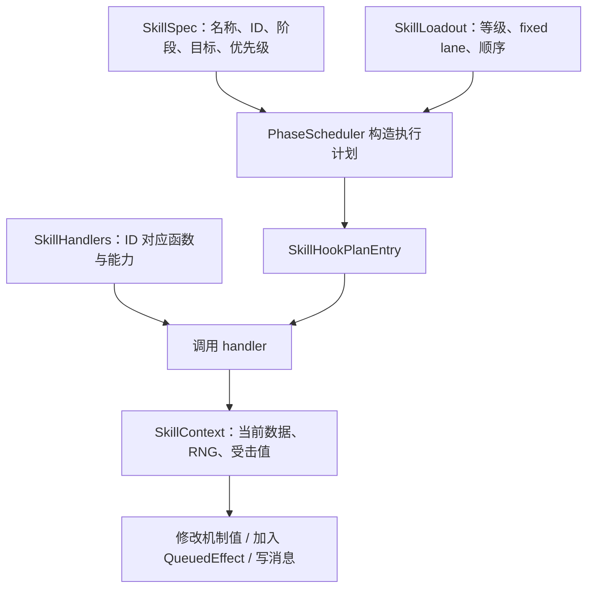
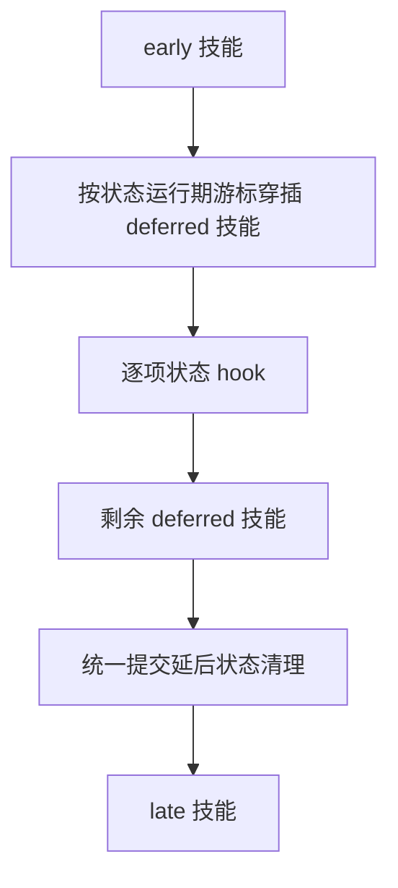

# 技能与 hook：注册、阶段、排序和实际执行

[指南首页](README.md) · 上一篇：[战斗流程](battle-flow.md) · 下一篇：[状态与召唤物](statuses-and-minions.md)

hook 是一项机制获得执行机会的位置。对熟悉游戏的人来说，最自然的例子是：行动前蓄盾、受击前反弹、受击后防御、死亡时护身符、击杀后吞噬。Runtime 把这些机会写成明确的阶段，再根据技能与状态元数据选择执行项。

## 一项技能包含哪些部分



图：元数据、角色技能和实现函数在执行阶段汇合。注册表描述“这是什么机制”，loadout 描述“这个角色拥有多少熟练度”，handler 描述“具体怎样执行”。

## 八种 hook 的定位

| `ProcMask` | 主要阶段 | 默认规则中的观察点 |
| --- | --- | --- |
| `PRE_ACTION` | 行动开始前 | 护盾积累、行动前状态准备 |
| `POST_ACTION` | 行动后的收尾 | 守护、持续状态、蓄力等 |
| `PRE_DAMAGE` | 主线普通攻击分支之前 | 行动者的攻击前机制 |
| `POST_DAMAGE` | 主线攻击分支之后；专用受伤链也使用此类技能 | 反击等受伤后行为，需看实际调用 owner |
| `PRE_DEFEND` | 受击者处理浮点攻击威力 | 反弹、守护链 |
| `POST_DEFEND` | 受击者处理整数伤害 | 防御、护盾、铁壁、诅咒等 |
| `DIE` | 致命伤害链 | 护身符等改变最终死亡结果 |
| `KILL` | 满足条件的击杀后链 | 吞噬、亡灵相关效果 |

多个位可用 `|` 合并。`ProcMask::NONE` 也有明确用途：许多主动技能通过 `BuiltinActiveSkill` 的专用行动分支执行，hook mask 表示其附加生命周期参与情况。

### 主动技能与阶段 hook 的协作

火、冰、雷、地震、吸血、毒、连击、暴击等进入攻击家族；魅惑、加速、减速、治疗、复活、驱散、铁壁等进入控制/状态/恢复分支；召唤、分身、幻术等进入实体生命周期分支。

行动选择先决定使用哪个主动技能，再执行该技能的专用目标与效果逻辑。被动技能和状态在相应阶段参与，完整行动因此是“专用主体 + 周围生命周期”的组合。

## fixed lane 与尝试顺序

| 数据 | 解决的问题 |
| --- | --- |
| `fixed_lane` | 到哪里读取这个技能的数据？ |
| `level` / `build_level` | 当前熟练度与构建时等级分别是多少？ |
| `active_order` | 按什么顺序尝试/遍历技能？ |
| `pre_action_order` / `post_damage_order` | 特定兼容链的技能顺序 |
| `post_action_after_states` | 在本次状态链的哪个注册游标后执行新增技能？ |

handler 从 `SkillHookPlanEntry.fixed_lane` 读取当前等级。吞噬或技能写入可以改变当前配置，loadout 的 generation 会帮助 Runtime 在必要阶段重建计划。

## 先后关系怎样确定

一般技能 hook 计划按 `(priority, active_order, registration_order)` 排序，数值较小的 priority 先执行。一般状态计划按 `(priority, registration_order)` 稳定排序；运行期注册位置另外保存在 `runtime_registration_order`。

POST_ACTION 采用更细的链路：



图：行动后阶段的分区。early 执行或状态链中发生技能变化时，Runtime 按 generation 更新相关计划，再继续后续阶段。这能保持吞噬中途注册、状态到期和尾阶段机制的顺序。

## 上下文提供什么

| 上下文 | 主要使用者 | 可使用的信息 |
| --- | --- | --- |
| `SkillContext` | 技能 handler | owner、当前等级、选定目标、受击值、RNG、专用修改和效果队列 |
| `StateContext` | 状态 handler | 当前 hook、状态 owner、载荷、受击值、行动接管与延后清理 |
| `EffectContext` | 自定义效果 handler | caster/target、槽、RNG、嵌套队列和更新消息 |

PRE_DEFEND 使用 `Atp`，POST_DEFEND 使用 `Damage`；选择匹配阶段的 getter/setter，就能清楚表达意图。上下文能力通过 `ReadAllies`、`ReadEnemies`、`ReadBattleSlots`、`ReadTemplateSlots`、`MutateEntitySlots` 等声明，并在 handler 绑定时显式传递。

这些能力检查用于组织同进程扩展的访问边界，具体授予范围取决于上下文方法。例如 Skill/State 的跨实体读取按队伍关系检查，EffectContext 的额外实体访问使用它自己的规则。

## 一个可运行的低层例子

下面展示“行动前给自己恢复 1 点”的完整接入步骤，采用最小模板，便于单独研究 hook。

```rust
use tswn_core::runtime::{
    ExtensionRegistryBuilder, PlayerTemplate, PreparedCombatTemplate, ProcMask,
    QueuedEffect, RuntimeRunner, SkillContext, SkillHookPlanEntry, SkillPriority,
    TargetPolicy,
};

fn recover(context: &mut SkillContext<'_>, entry: &SkillHookPlanEntry) {
    let owner = context.owner_idx();
    context.push_nested(QueuedEffect::Heal {
        caster: owner,
        target: owner,
        amount: context.skill_level(entry) as i32,
    });
}

fn main() -> Result<(), Box<dyn std::error::Error>> {
    let mut builder = ExtensionRegistryBuilder::default();
    let skill = builder.register_skill_with_hooks(
        "demo", "recover", "demo.skill.recover",
        ProcMask::PRE_ACTION, TargetPolicy::None, SkillPriority(0),
    )?;
    let players = vec![
        PlayerTemplate::new(1, "left", 0, 20, 4).with_skills([skill]),
        PlayerTemplate::new(2, "right", 1, 20, 4),
    ];
    let mut runner = RuntimeRunner::from_template(
        PreparedCombatTemplate::with_registry(players, builder.build()),
    );
    runner.runtime_mut().set_skill_handler(skill, recover);
    runner.validate_ready()?;
    let outcome = runner.run_round();
    assert!(outcome.action.is_some());
    Ok(())
}
```

完整体力时恢复量按结算规则钳制；你可以继续推进，观察受伤后的恢复。此例同时作为 Cargo doc 的可执行示例验证。

## 把低层机制接到整个项目

| 接入层次 | 后续工作 |
| --- | --- |
| Runtime | 注册 spec、配置 loadout、绑定 handler、验证执行行为 |
| 普通名字/OL | 给构建、导入和蓝图提供对应技能映射 |
| 展示 | 组织 RunUpdate、状态快照和播放投影 |
| 绑定 | 按需要提供宿主可用的类型和错误转换 |
| 学习数据 | 审计载荷、注册表、词表、容量与编码契约 |

`TswnExtension` 将名称、版本、能力和注册步骤组织在一起；实际函数绑定继续由 Runtime 完成。它适合显式的 Rust 组合式扩展。

## 源码入口

- [extension.rs](../../crates/tswn_core/src/runtime/extension.rs)：spec、ID、策略与 builder。
- [scheduler.rs](../../crates/tswn_core/src/runtime/scheduler.rs)：排序和 POST_ACTION 分区。
- [effect/](../../crates/tswn_core/src/runtime/effect)：上下文、handler 和队列。
- [profile/registry.rs](../../crates/tswn_core/src/runtime/profile/registry.rs)、[hooks.rs](../../crates/tswn_core/src/runtime/profile/hooks.rs)：默认规则的元数据与实现。
- [combat/round.rs](../../crates/tswn_core/src/runtime/combat/round.rs)：具体生命周期调用位置。

---

[指南首页](README.md) · 上一篇：[战斗流程](battle-flow.md) · 下一篇：[状态与召唤物](statuses-and-minions.md)
