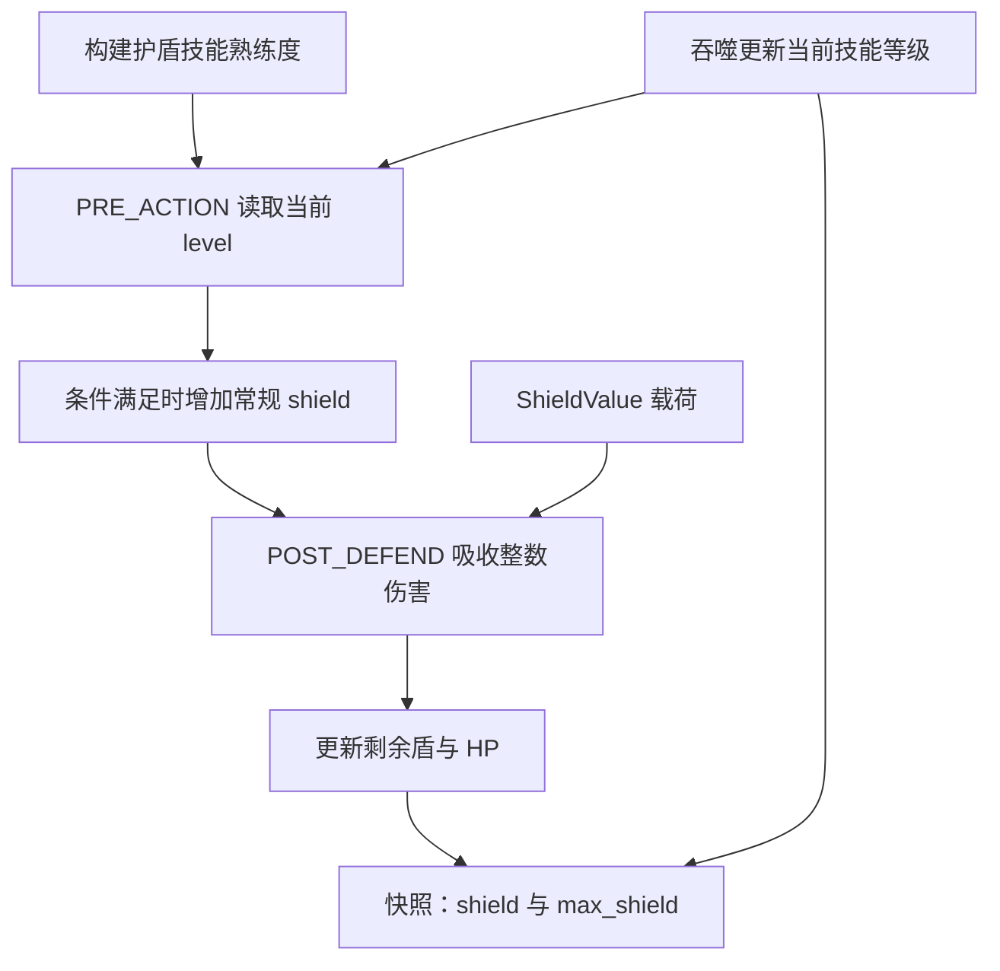
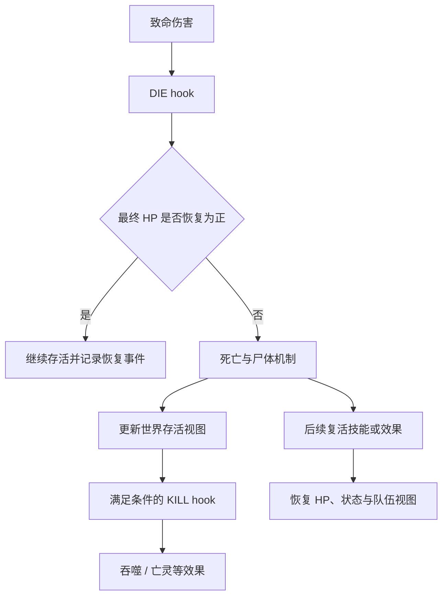

# 状态、护盾与召唤物：持续机制怎样保存和变化

[指南首页](README.md) · 上一篇：[技能与 hook](skills-and-hooks.md) · 下一篇：[随机与兼容](randomness-and-compatibility.md)

技能描述一次机会，状态描述后续仍然有效的机制，召唤物则引入新的实体及其归属。core 把这三者联系起来，让游戏中的“中毒几次”“加速多久”“谁的使魔”“吞噬后变强”都有对应数据。

## 状态由载荷和生命周期组成

`StateEntry` 保存状态类别、可选扩展 ID、hook mask、优先级和注册序；`StatePayload` 保存实际参数。`StateStore` 负责注册、清理、查找和计划 generation。

| 状态族 | 主要载荷 | 在游戏中的观察方式 |
| --- | --- | --- |
| 火球叠层 | `FireMagHalfSteps` | 后续火攻击倍率资料 |
| 冰冻 | `Ice.frozen_step` | 行动条步进和解除 |
| 中毒 | 来源、威力 bits、count | 行动后毒跳、次数与来源 |
| 加速 | faster、effective_faster、step | 有效速度及持续步数 |
| 减速 / 狂暴 | step | 速度或行动分支变化 |
| 魅惑 | 原组、有效队伍、来源队伍、目标、step | 临时目标与阵营语义 |
| 诅咒 | prob、multiply | 受击与有效属性相关机制 |
| 铁壁 | protect、step | 受击减伤与持续周期 |
| 扩展护盾 | `ShieldValue` | 吸收伤害的剩余数值 |
| Boss / 感染 | 变异、来源、天数、命中/回合等 | Boss 专用行为及其关系 |

这张表用于找到数据位置。每个状态的精确更新条件，沿它的 handler 与对应效果分支查看，就能同时看到随机消费、消息和清理时机。

## 为什么部分状态在专用字段里

常用机制使用专用 runtime 字段或压缩标记，例如常规 shield、守护关系、强化和尸体类别。通用载荷适合表达多种状态，专用字段则让常见查询和结算更直接。

两种表示共同参与完整机制。压缩状态登记也推进注册游标，帮助保持后续吞噬新增 hook 的相对位置。展示 `status_labels` 把这些数据整理成人类可读文本；机制分析使用实际字段与载荷。

## 护盾的一生

图：熟练度、实际盾值和展示上限分别来自不同数据，受同一场战斗的机制变化驱动。

| 数据 | 含义 | 使用方式 |
| --- | --- | --- |
| `PlayerRuntime.shield` | 常规蓄盾当前值 | 行动前积累、受击吸收 |
| `StatePayload::ShieldValue` | 另一种载荷盾当前值 | 相应状态受击处理 |
| 展示 `shield` | 当前可吸收盾合计 | 常规盾加 ShieldValue，死亡投影为 0 |
| 展示 `max_shield` | 当前护盾技能熟练度 | 随技能变化更新的条长基准 |
| `Iron.protect` | 铁壁机制的减伤资料 | 按铁壁自己的结算路径应用 |

默认蓄盾 handler 在当前常规盾值小于或等于 level 时继续累积，增加量为 `next_i32(max(1, 1 + level × 3 / 4)) + 1`。一次增加可以让实际盾值超过 level，展示会保留真实数值，并按当前熟练度计算条长。

WASM 页面按当前 `max_shield` 计算盾条尺度：只有护盾变化时独占条形槽位，HP 与护盾同时变化时叠在 HP 底轨正上方（左端对齐、上下紧贴）；前后盾值均为 0 时不保留空底轨。有剩余护盾时详情状态显示 `护盾 +xx`，吞噬后尺度随下一份快照变化。

## 死亡、护身符与复活

图：致命伤害先给 DIE 阶段执行机会，再按最终状态继续死亡链。KILL 还会考虑击杀者、目标和剩余敌人/待生成实体，最后一名敌人消失时有相应分支。

死亡实体可以保留在 roster 和 arena 中，以支持复活、尸体以及来源关系；存活列表随生命周期维护。`alive` 是存活登记，`active` 进一步结合正 HP 表示当前活动状态。

## 分身、幻影、使魔与丧尸

| 实体类别 | 数据来源 | 关键关系或策略 |
| --- | --- | --- |
| 分身 Clone | 本体的派生资料与衰减 | clone_build、显示序号、技能与属性变化 |
| 幻影 Shadow | 角色的 shadow 蓝图或覆盖 | owner / root_owner、特定技能与重施规则 |
| 使魔 Summon | summon 蓝图或延迟构造 | 召唤实例引用、伤害分享、重施继承 |
| 丧尸 Zombie | zombie 蓝图和击杀相关机制 | 尸体与生成链、归属、技能/属性策略 |
| bed2 自定义召唤物 | custom profile 的模板槽 | 根主人解析、共享伤害和防抗继承策略 |

`owner` 指向直接主人，`root_owner` 指向根来源。嵌套生成时，这两个关系为来源队伍标签和策略提供依据。种类 flags 与 `PlayerKindPolicies` 共同决定实际行为。

### 蓝图与实例

蓝图是生成所需的 PlayerTemplate，实例是 arena 里的 EntityRecord。生成时可以消耗预留 ID、更新世界顺序并登记实例；重施时再根据蓝图的 `reuse_skills_on_recast`、统计复用和防抗继承策略处理。

分身的八围、武器修正、名字因子与技能强化由 `CloneBuildData` 保存，便于继续派生和吞噬。完整推导见 [分身机制分析](../mechanics/README.md)。

## 吞噬为什么同时影响好几处

吞噬通过种类对应的 merge policy 处理属性和技能映射。它可能更新 max HP、当前技能等级、尝试顺序以及新增阶段 hook，所以 Runtime 会刷新相应有效属性与计划。

展示层每次从当前数据投影，学习状态同时保存模板、runtime、载荷和顺序；这使同一次吞噬在游戏数值、盾条上限和机制数据中都有一致来源。

## 源码入口

- [entity/state.rs](../../crates/tswn_core/src/runtime/entity/state.rs)、[state/store.rs](../../crates/tswn_core/src/runtime/entity/state/store.rs)。
- [profile/hooks.rs](../../crates/tswn_core/src/runtime/profile/hooks.rs)：护盾、反弹、防御、护身符等。
- [handlers/](../../crates/tswn_core/src/runtime/handlers)：导出的默认状态 handler。
- [combat/skills_lifecycle.rs](../../crates/tswn_core/src/runtime/combat/skills_lifecycle.rs)、[lifecycle.rs](../../crates/tswn_core/src/runtime/combat/lifecycle.rs)：实体生命周期。
- [session.rs](../../crates/tswn_core/src/runtime/session.rs)：护盾、归属与状态标签投影。

---

[指南首页](README.md) · 上一篇：[技能与 hook](skills-and-hooks.md) · 下一篇：[随机与兼容](randomness-and-compatibility.md)
