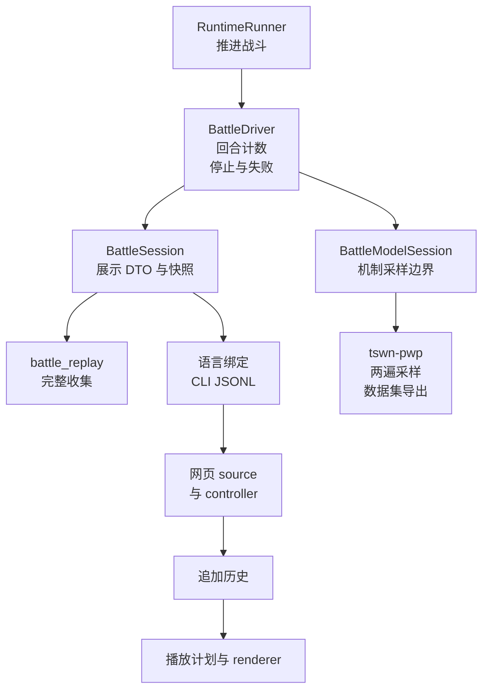

# BattleSession 与网页增量播放的设计

[返回设计索引](README.md)

本文说明已实现的会话分层、数据所有权和关键设计取舍。调用方法、字段、默认值、错误码及 C ABI 约定统一查阅 [公共 API](../reference/public-api.md)；从游戏概念理解会话见 [原理指南：会话与回放](../core-guide/sessions-and-replay.md)。

## 核心分层

| 层 | 持有的数据 | 主要职责与源码 |
| --- | --- | --- |
| Runtime | 实体、世界视图、调度器、随机流与效果队列 | [RuntimeRunner](../../crates/tswn_core/src/runtime/runner.rs)：执行机制；批量工具也直接使用这一层 |
| 共用驱动 | Runtime、推进计数、停止原因、首个运行错误 | [BattleDriver](../../crates/tswn_core/src/cli_api/battle/driver.rs)：把每次真实主回合计入预算，统一终止与失败策略 |
| 展示会话 | 初始/当前快照、差分快照、图标缓存 | [BattleSession](../../crates/tswn_core/src/cli_api/battle/session.rs)：将可见更新投影成规范 frame；空回合后也同步差分快照 |
| 机制会话 | 同一个驱动及可见帧末元数据 | [BattleModelSession](../../crates/tswn_core/src/cli_api/battle/model_session.rs)：提供采样边界和机制状态，省去展示 DTO 的构造成本 |
| 完整回放 | 初始状态、全部 frame、最终结果 | [battle_replay](../../crates/tswn_core/src/cli_api/battle/replay.rs)：收集展示会话，方便一次性消费与保存 |
| 语言绑定 | 宿主侧句柄、对象和异常 | [Python](../../crates/tswn_py/src/battle.rs)、[WASM](../../crates/tswn_wasm/src/battle.rs)、[C](../../crates/tswn_capi/src/battle_api.rs)：转换同一份 core 契约 |

驱动负责“战斗计算到哪里”，会话负责“这个边界输出什么”。两种会话共用停止策略，展示路径和数据采样路径因此能在相同输入、seed 与预算下对齐。

## 网页的三个游标

网页分别维护**源端推进位置、已接收历史尾部、当前播放位置**。源端只向前计算；历史按 frame 顺序追加；播放可以在已有历史中来回移动。

| 模块 | 职责 |
| --- | --- |
| [show-wasm.js](../../crates/tswn_wasm/examples/show-wasm.js) | 加载 WASM、创建 source、先复制 initial states、拉取 frame、保存终局结果并释放 session |
| [show-stream.js](../../crates/tswn_wasm/examples/show-stream.js) | 管理追加历史、两帧预取缓冲、observer、单次在途拉取及 source 生命周期 |
| [show-replay.js](../../crates/tswn_wasm/examples/show-replay.js) | 把规范 frame 转为显示块与播放计划 |
| [show-playback.js](../../crates/tswn_wasm/examples/show-playback.js) | 推进播放、暂停/恢复、逐事件/逐帧导航、回退及历史续播 |
| [show-display.js](../../crates/tswn_wasm/examples/show-display.js) | 从规范数据派生昵称、图标和显示模型 |

点击开始后，页面先显示初始双方，再按需拉帧。暂停停止自动补帧，回退和重播使用已保存历史；播放追上历史尾部后继续同一 source。终局计算可以先于终局动画完成，最终结果在释放 WASM 句柄前复制到宿主侧。

重新开局或关闭 source 时，generation 变化使旧异步拉取的迟到结果留在旧会话。controller 在终局、错误或 dispose 时释放 source；source 的释放入口负责显式 `free()`。收到错误后，已有历史仍可回看，界面通过错误事件解释停止原因。

## 关键设计理由

| 决策 | 得到的能力 | 契约与实现入口 |
| --- | --- | --- |
| 停止策略集中于 driver | 展示、机制采样和跨语言会话使用相同的真实回合预算与优先级 | [会话与结果](../reference/public-api.md#会话与结果)、[driver.rs](../../crates/tswn_core/src/cli_api/battle/driver.rs) |
| 运行错误独立查询，并保留首个错误 | 正常终局结果与运行失败分别表达；重复推进能得到一致错误 | [错误与其他高层 API](../reference/public-api.md#错误与其他高层-api)、[session.rs](../../crates/tswn_core/src/cli_api/battle/session.rs) |
| 身份区分直接 owner 和根 source | 多层召唤物可以同时表达直接所属与根来源 | [规范 DTO](../reference/public-api.md#规范-dto)、[兼容映射](../../crates/tswn_wasm/src/fight.rs) |
| C options 读取固定 V1 prefix，并按大小识别后续字段 | 不同代 caller 与 library 可识别双方提供的选项范围；旧初始化器保持原写入尺寸 | [C ABI 4](../reference/public-api.md#c-abi-4)、[battle_api.rs](../../crates/tswn_capi/src/battle_api.rs) |
| Rust DTO 是跨语言数据定义的共同来源 | Python dict、JS object、C JSON 与 CLI payload 可以逐字段对照 | [dto.rs](../../crates/tswn_core/src/cli_api/battle/dto.rs)、[真实跨绑定验证](../../scripts/verify_battle_cross_binding.py) |
| 规范历史与显示模型分离 | 昵称、播放计划和检查点可以重建；源数据仍适合回放和对账 | [显示层](../../crates/tswn_wasm/examples/show-display.js)、[播放模块](../../crates/tswn_wasm/examples/show-playback.js) |
| source 采用异步接口 | 现有同步 WASM 可以包装为 source，未来宿主调度也能复用 controller | [source 实现](../../crates/tswn_wasm/examples/show-wasm.js)、[controller](../../crates/tswn_wasm/examples/show-stream.js) |

## 演进与验证

新增展示字段时，先在 core 投影中表达事实，再同步各绑定类型和实际 payload 验证。新增机制采样能力时，从 `BattleModelState` 与数据契约展开；预测结果可作为 frame 的消费者，按 generation/frame 保存并在相应帧播放完成后显示。相关设计见 [状态与数据生成](battle-analyze.md#后续训练和网页约束)。

验证按数据流选择入口：core 会话测试与 `tswn_test` 对照边界，真实跨绑定脚本比较 payload，前端模块测试与 DOM 验证覆盖播放和释放。可执行命令集中于 [开发指南](../guides/development.md#验证怎么选) 和 [脚本索引](../../scripts/README.md#battlesession-验收)。

性能选择基于测量：网页的首屏、首帧和拉帧耗时见 [Web Streaming 基线](../perf/reports/web-streaming-baseline.md)；Python DTO 转换路径的测量与优化判断见 [Python 基线](../perf/reports/python-battle-session-baseline.md)。报告中的数值按各自提交、输入和环境解读。

## 历史来源

本页合并已完成的重构与加固设计，只保留现行结构和决策理由。原阶段的逐条实施清单、代码草图、提交建议与当时验收记录可通过 Git 历史查阅：[原重构计划](https://github.com/shenjackyuanjie/tswn-core/blob/821e3d47439983099e256bc2a07898a8b999bef8/docs/design/battle-session-plan.md)、[原加固提案](https://github.com/shenjackyuanjie/tswn-core/blob/821e3d47439983099e256bc2a07898a8b999bef8/docs/design/battle-session-hardening.md)。
